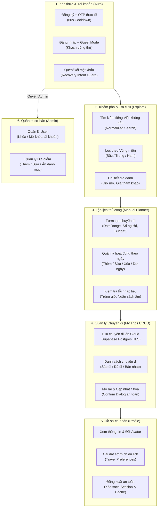

# CẨM NANG ÔN TẬP CÁC CHỨC NĂNG CƠ BẢN DỰ ÁN TRAVELGO
> **Dành cho:** Toàn bộ thành viên nhóm chuẩn bị bảo vệ đồ án.  
> **Mục tiêu:** Nắm vững từng luồng nghiệp vụ cơ bản (CRUD, Form Validation, Lưu/Mở chuyến đi, Tìm kiếm, Phân quyền) và tự tin "bắn trả" các câu hỏi vặn vẹo nền tảng của Thầy Cô.

---

## TẠI SAO PHẢI HỌC KỸ CÁC CHỨC NĂNG CƠ BẢN?

> [!WARNING] Cảnh báo từ các buổi bảo vệ đồ án thực tế
> Hơn **70% sinh viên bị mất điểm hoặc bị Thầy đánh trượt** không phải vì phần AI khó, mà vì **chủ quan với các chức năng cơ bản**. Thầy Cô thường bắt đầu bằng các thao tác cơ bản nhất (Đăng ký, gõ sai format, tắt mạng khi lưu, xóa dữ liệu, tìm kiếm tiếng Việt). Nếu luồng cơ bản bị crash, hổng bảo mật hoặc không giải thích được luồng code, Thầy sẽ đánh giá sản phẩm chưa đạt yêu cầu phần mềm!

---

## PHẦN 1: BẢN ĐỒ 6 NHÓM CHỨC NĂNG CƠ BẢN

---

## PHẦN 2: CHI TIẾT NỘI DUNG HỌC TỪNG CHỨC NĂNG CƠ BẢN

### 1. Phân hệ Xác thực (Authentication Flow)
- **Mã nguồn mấu chốt:**
  - Screens: [`register_screen.dart`](file:///d:/Travel-Go-Android/travel-go/lib/features/auth/presentation/screens/register_screen.dart), [`login_screen.dart`](file:///d:/Travel-Go-Android/travel-go/lib/features/auth/presentation/screens/login_screen.dart), [`otp_verification_screen.dart`](file:///d:/Travel-Go-Android/travel-go/lib/features/auth/presentation/screens/otp_verification_screen.dart), [`forgot_password_screen.dart`](file:///d:/Travel-Go-Android/travel-go/lib/features/auth/presentation/screens/forgot_password_screen.dart).
  - Provider: [`AuthProvider`](file:///d:/Travel-Go-Android/travel-go/lib/features/auth/providers/auth_provider.dart).

- **Cơ chế hoạt động chi tiết:**
  1. **Đăng ký:**
     - Client kiểm tra Form Validation: Email đúng định dạng regex `r'^[\w-\.]+@([\w-]+\.)+[\w-]{2,4}$'`, mật khẩu tối thiểu 8 ký tự, có xác nhận mật khẩu khớp nhau.
     - Gọi `SupabaseClient.auth.signUp(email, password)`. Supabase tự động gửi mã OTP 6 số về hòm thư người dùng.
     - Chuyển sang màn hình `OtpVerificationScreen`.
  2. **Xác thực OTP:**
     - Có đồng hồ đếm ngược 60 giây (`Timer.periodic`). Hết 60s mới cho phép bấm "Gửi lại mã OTP" (Resend OTP) để chống spam email.
     - Ô nhập OTP gồm 6 ô số tự động nhảy focus sang ô kế tiếp khi gõ phím. Khi đủ 6 số, hệ thống tự động gọi `verifyOTP()`.
  3. **Chế độ Khách (Guest Mode):**
     - Cho phép người dùng bấm "Dùng thử không cần đăng nhập" để trải nghiệm tính năng Khám phá và Tự lập lịch nháp.
     - Biến `_isGuest = true`. Khi người dùng bấm "Lưu vào tài khoản", hệ thống sẽ chặn lại và hiển thị Modal yêu cầu đăng nhập.
  4. **Quên & Đặt lại mật khẩu:**
     - Nhập email $\rightarrow$ Supabase gửi link/token recovery $\rightarrow$ Ứng dụng đón nhận qua Deep Link $\rightarrow$ Kích hoạt `_isRecovering = true` $\rightarrow$ Chuyển thẳng sang `ResetPasswordScreen` bắt buộc nhập mật khẩu mới.

---

### 2. Phân hệ Khám phá & Tra cứu (Explore & Search)
- **Mã nguồn mấu chốt:**
  - Screens: [`explore_screen.dart`](file:///d:/Travel-Go-Android/travel-go/lib/features/explore/presentation/screens/explore_screen.dart), [`destination_detail_screen.dart`](file:///d:/Travel-Go-Android/travel-go/lib/features/explore/presentation/screens/destination_detail_screen.dart).
  - Repository & Parser: [`public_catalogue_repository.dart`](file:///d:/Travel-Go-Android/travel-go/lib/features/explore/services/public_catalogue_repository.dart), [`public_catalogue_parser.dart`](file:///d:/Travel-Go-Android/travel-go/lib/features/explore/services/public_catalogue_parser.dart).

- **Cơ chế hoạt động chi tiết:**
  1. **Tìm kiếm tiếng Việt không dấu (Unaccented Search):**
     - Người dùng gõ "da nang" hay "đà nẵng" đều tìm ra điểm đến.
     - **Giải pháp code:** Hệ thống chuẩn hóa chuỗi bằng hàm `removeDiacritics()` (chuyển các ký tự có dấu `á, à, ả, ã, ạ, â, đ...` về dạng không dấu `a, d...` và chuyển về chữ thường `toLowerCase()`) trước khi so sánh chuỗi con `contains()`.
  2. **Bộ lọc Vùng miền (Region Filter):**
     - Chia danh mục theo 3 miền: Bắc (`north`), Trung (`central`), Nam (`south`).
     - Khi bấm chọn Chip tab miền nào, Provider thực hiện lọc danh sách trong bộ nhớ cache local tức thì, không cần gọi lại API tốn tài nguyên.
  3. **Chi tiết Điểm đến (Destination Detail):**
     - Hiển thị danh sách các địa danh tham quan (`discovery_places`).
     - Thể hiện trung thực: Giờ mở cửa, Giá vé tham khảo, Hình ảnh thumbnail, và Nguồn xác minh (Website chính thức, cổng thông tin du lịch).

---

### 3. Phân hệ Lập Kế Hoạch Thủ Công (Manual Trip Planner CRUD)
- **Mã nguồn mấu chốt:**
  - Screens: [`manual_planner_entry_screen.dart`](file:///d:/Travel-Go-Android/travel-go/lib/features/trip_planner/presentation/screens/manual_planner_entry_screen.dart), [`manual_planner_screen.dart`](file:///d:/Travel-Go-Android/travel-go/lib/features/trip_planner/presentation/screens/manual_planner_screen.dart).
  - Services: [`editable_trip_validator.dart`](file:///d:/Travel-Go-Android/travel-go/lib/features/trip_planner/services/editable_trip_validator.dart), [`editable_trip_mutator.dart`](file:///d:/Travel-Go-Android/travel-go/lib/features/trip_planner/services/editable_trip_mutator.dart).

- **Cơ chế hoạt động chi tiết (Thực hiện CRUD hoạt động):**
  1. **Khởi tạo chuyến đi:**
     - Người dùng nhập Tên chuyến đi, Nơi xuất phát, Điểm đến, Chọn khoảng ngày (dùng `showDateRangePicker`), Số người (dùng Counter +/-), và Hạn mức ngân sách.
  2. **Thêm hoạt động (Create):**
     - Chọn ngày (Tab Day 1, Day 2...). Bấm "Thêm hoạt động".
     - Có thể chọn địa điểm từ Catalogue gợi ý hoặc tự nhập tên tự do.
     - Chọn mốc giờ bằng `showTimePicker` (tự động chuyển thành `startMinute` và `endMinute`). Nhập chi phí dự kiến.
     - Gọi `EditableTripMutator._insert()`.
  3. **Sửa hoạt động (Update):**
     - Bấm vào thẻ hoạt động $\rightarrow$ Mở Bottom Sheet biên tập $\rightarrow$ Đổi giờ, sửa ghi chú hoặc đổi chi phí $\rightarrow$ Gọi `EditableTripMutator._update()`.
  4. **Xóa hoạt động (Delete):**
     - Vuốt sang trái (Dismissible) hoặc bấm nút Thùng rác $\rightarrow$ Có hộp thoại xác nhận $\rightarrow$ Gọi `EditableTripMutator._remove()`.
     - *Nhớ kỹ chi tiết vàng:* Tiền thực chi gắn với hoạt động này không bị xóa mất mà được lưu snapshot lại trong sổ cái chi tiêu!
  5. **Dời ngày / Đổi thứ tự:**
     - Người dùng có thể đổi ngày của hoạt động từ Day 1 sang Day 2. Hệ thống gọi `_move(doc, itemId, targetDayId, targetPosition)` và tự động sắp xếp lại thứ tự các hoạt động còn lại.

---

### 4. Phân hệ Quản Lý Chuyến Đi Theo Tài Khoản (My Trips CRUD)
- **Mã nguồn mấu chốt:**
  - Screen: [`my_trips_screen.dart`](file:///d:/Travel-Go-Android/travel-go/lib/features/trips/presentation/screens/my_trips_screen.dart), [`editable_trip_detail_screen.dart`](file:///d:/Travel-Go-Android/travel-go/lib/features/trips/presentation/screens/editable_trip_detail_screen.dart).
  - Service & Repository: [`editable_trip_repository.dart`](file:///d:/Travel-Go-Android/travel-go/lib/features/trips/services/editable_trip_repository.dart), [`editable_trip_service.dart`](file:///d:/Travel-Go-Android/travel-go/lib/features/trips/services/editable_trip_service.dart).

- **Cơ chế hoạt động chi tiết:**
  1. **Lưu chuyến đi lên Cloud (Create / Update Remote):**
     - Khi bấm "Lưu vào tài khoản", hệ thống gọi `EditableTripValidator.validate(document, mode: ValidationMode.accountSave)`.
     - Nếu thiếu tên, thiếu điểm đến hoặc ngày kết thúc trước ngày bắt đầu $\rightarrow$ Chặn lại và báo đỏ form.
     - Nếu hợp lệ $\rightarrow$ Mã hóa qua `TripEvidenceCodec.encode()` $\rightarrow$ Gọi hàm RPC PostgreSQL `save_trip_with_evidence` trên Supabase. Chuyến đi được gán `user_id = auth.uid()`.
  2. **Hiển thị danh sách chuyến đi (Read):**
     - Tải danh sách chuyến đi từ bảng `trips` theo `user_id` hiện tại.
     - Sử dụng [`TripListClassifier`](file:///d:/Travel-Go-Android/travel-go/lib/features/trips/services/trip_list_classifier.dart) phân loại thành:
       - **Sắp đi (Upcoming):** Ngày bắt đầu $>=$ ngày hiện tại.
       - **Đã đi (Completed):** Ngày kết thúc $<$ ngày hiện tại.
       - **Bản nháp (Draft):** Chuyến đi chưa chọn đủ ngày tháng.
  3. **Mở lại & Sửa tiếp (Reopen & Edit):**
     - Bấm vào một chuyến đi trong danh sách $\rightarrow$ Mở `EditableTripDetailScreen`.
     - Toàn bộ các ngày, hoạt động, mốc giờ, chi phí dự kiến và chi tiêu thực tế được khôi phục 100% lên giao diện.
     - Người dùng bấm "Chỉnh sửa" $\rightarrow$ Dữ liệu nạp ngược lại vào `ManualTripPlannerProvider` để tiếp tục thêm/sửa/xóa.
  4. **Xóa chuyến đi (Delete):**
     - Bấm nút Xóa $\rightarrow$ Hiển thị Alert Dialog: *"Bạn có chắc chắn muốn xóa chuyến đi này không? Thao tác này không thể hoàn tác."*.
     - Người dùng bấm Đồng ý $\rightarrow$ Gọi `repository.deleteTrip(tripId)` $\rightarrow$ Xóa dòng dữ liệu trên Supabase và xóa khỏi danh sách trên màn hình.

---

### 5. Phân hệ Hồ sơ Cá nhân (Profile & Preferences)
- **Mã nguồn mấu chốt:**
  - Screen: [`profile_screen.dart`](file:///d:/Travel-Go-Android/travel-go/lib/features/profile/presentation/screens/profile_screen.dart).

- **Cơ chế hoạt động chi tiết:**
  1. **Xem thông tin người dùng:** Hiển thị Email, Tên đầy đủ, Mã tài khoản (UUID) và Huy hiệu vai trò (`CUSTOMER` hoặc `ADMIN`).
  2. **Sở thích du lịch (Travel Preferences):**
     - Người dùng chọn các Tag sở thích: Ẩm thực, Khám phá thiên nhiên, Nghỉ dưỡng biển, Di tích lịch sử, Check-in sống ảo...
     - Các sở thích này được lưu vào bảng `user_profiles` và tự động dùng làm ngữ cảnh gợi ý khi người dùng nhờ AI tạo lịch trình.
  3. **Đăng xuất (Logout):**
     - Xóa Session Token của Supabase.
     - Xóa dữ liệu nháp trong Provider.
     - Tăng biến `_authEpoch` để hủy các request mạng cũ đang chờ phản hồi.
     - Chuyển hướng người dùng về màn hình Đăng nhập (`LoginScreen`).

---

### 6. Phân hệ Quản trị Viên Cơ bản (Admin Features)
- **Mã nguồn mấu chốt:**
  - Screens: [`admin_users_screen.dart`](file:///d:/Travel-Go-Android/travel-go/lib/features/admin/presentation/screens/admin_users_screen.dart), [`admin_catalogue_screen.dart`](file:///d:/Travel-Go-Android/travel-go/lib/features/admin/presentation/screens/admin_catalogue_screen.dart).

- **Cơ chế hoạt động chi tiết:**
  1. **Quản lý Người dùng (Admin Users):**
     - Xem danh sách toàn bộ tài khoản đăng ký trên hệ thống.
     - Tìm kiếm người dùng theo Email hoặc Tên.
     - Thao tác Khóa / Mở khóa tài khoản: Gọi Edge Function `admin-control` để cập nhật trạng thái `is_blocked`. Tài khoản bị khóa sẽ bị cưỡng chế đăng xuất ngay lập tức ở lần gọi API tiếp theo.
  2. **Quản lý Danh mục Điểm đến (Admin Catalogue):**
     - Thêm điểm đến mới (`destination`), nhập tên, mô tả, hình ảnh, vùng miền.
     - Thêm/sửa địa danh tham quan (`discovery_place`): Nhập tên địa điểm, giá vé, giờ mở/đóng cửa, liên kết nguồn xác minh.
     - Ẩn/Hiện địa điểm khi có thay đổi thực tế.

---

## PHẦN 3: BỘ CÂU HỎI XOÁY VỀ CÁC CHỨC NĂNG CƠ BẢN

#### Câu 1: Em thực hiện Form Validation ở đâu? Nếu kẻ xấu dùng Postman gửi request không qua app di động thì có ghi dữ liệu sai vào Database được không?
- **Trả lời chuẩn:**
  > "Dạ thưa Thầy/Cô, hệ thống áp dụng **Validation 2 lớp (Client-side và Server-side)**:
  > 1. **Tại Client:** Để mang lại trải nghiệm mượt mà, app kiểm tra ngay khi gõ phím (báo đỏ nếu thiếu tên, sai email, ngày kết thúc nhỏ hơn ngày bắt đầu).
  > 2. **Tại Server:** Nếu kẻ xấu bypass giao diện và dùng Postman gọi thẳng vào Supabase API:
  >    - Cơ sở dữ liệu PostgreSQL đã có các ràng buộc dữ liệu nghiêm ngặt: Ràng buộc khóa chính `UUID`, ràng buộc NOT NULL, ràng buộc CHECK (`start_date <= end_date`, `budget >= 0`).
  >    - Toàn bộ thủ tục lưu đều đi qua Postgres RPC `save_trip_with_evidence`, kiểm tra hợp lệ cấu trúc JSON Schema trước khi INSERT. Do đó, kẻ xấu tuyệt đối không thể ghi dữ liệu sai vào Database."

#### Câu 2: Tìm kiếm tiếng Việt em xử lý thế nào? Nếu người dùng gõ "ho chi minh" không dấu thì có tìm được "TP. Hồ Chí Minh" không? Thuật toán chạy ở máy người dùng hay trên Server?
- **Trả lời chuẩn:**
  > "Dạ thưa Thầy/Cô:
  > - Nhóm xây dựng cơ chế **Tìm kiếm chuẩn hóa tiếng Việt không dấu (Unaccented Search)**.
  > - Trước khi so sánh, chuỗi từ khóa của người dùng và tên địa điểm trong hệ thống đều được đưa qua hàm chuẩn hóa `removeDiacritics()`: chuyển toàn bộ ký tự có dấu (*ô, ồ, ế, đ...*) về dạng Latin chuẩn (*o, e, d...*) và chuyển về chữ thường (`toLowerCase()`).
  > - Vì danh mục điểm đến có dung lượng nhẹ và đã được đồng bộ vào bộ nhớ Cache của ứng dụng, thuật toán so sánh chuỗi con `contains()` chạy trực tiếp tại Client trong Provider. Nhờ vậy, kết quả hiển thị tức thì theo từng ký tự người dùng gõ phím (Realtime Search) mà không cần gửi request lên server, không gây nghẽn mạng."

#### Câu 3: Khi lưu một chuyến đi thì lưu những thông tin gì? Dữ liệu lưu dưới dạng bảng quan hệ nhiều-nhiều hay lưu kiểu gì?
- **Trả lời chuẩn:**
  > "Dạ, cấu trúc lưu trữ của TravelGO kết hợp tối ưu giữa **PostgreSQL Quan hệ và Tài liệu JSONB**:
  > - Bảng `trips` lưu các trường định danh cơ bản: `id` (UUID), `user_id` (khóa ngoại trỏ tới Auth), `title`, `destination_id`, `start_date`, `end_date`, `created_at`, `updated_at`.
  > - Toàn bộ cấu trúc chi tiết của chuyến đi (gồm danh sách các ngày, danh sách hoạt động, mốc giờ phút, sổ cái chi tiêu 3 cột và bằng chứng trích dẫn nguồn) được chuẩn hóa và lưu trong cột `document` kiểu **JSONB**.
  > - **Lý do chọn JSONB:** Lịch trình du lịch là dữ liệu dạng cây phân cấp (Trip $\rightarrow$ Days $\rightarrow$ Activities $\rightarrow$ Expenses). Việc lưu JSONB giúp đọc/ghi toàn bộ chuyến đi trong một query duy nhất, không cần JOIN 4-5 bảng phức tạp, tránh phân mảnh dữ liệu và đạt tốc độ phản hồi cực nhanh trên thiết bị di động."

#### Câu 4: Thao tác Xóa chuyến đi là Xóa mềm (Soft Delete) hay Xóa cứng (Hard Delete)? Tại sao?
- **Trả lời chuẩn:**
  > "Dạ thưa Thầy/Cô:
  > - Đối với **Chuyến đi cá nhân của Người dùng**: Hệ thống áp dụng **Hard Delete (Xóa hẳn dòng dữ liệu)** khi người dùng xác nhận xóa. Vì người dùng có toàn quyền sở hữu dữ liệu của mình (Quyền riêng tư cá nhân theo chuẩn GDPR), khi họ muốn xóa chuyến đi thì hệ thống xóa sạch khỏi cơ sở dữ liệu để giải phóng bộ nhớ.
  > - Đối với **Danh mục Địa điểm của Admin**: Hệ thống áp dụng **Soft Delete (Ẩn/Hiện bằng cờ `is_active = false`)**. Vì một địa danh có thể đang được tham chiếu trong lịch trình của nhiều người dùng khác; nếu xóa cứng sẽ gây lỗi toàn vẹn dữ liệu khóa ngoại."

#### Câu 5: Nếu người dùng đang dùng thử ở chế độ Khách (Guest Mode) rồi bấm "Lưu chuyến đi", app sẽ xử lý thế nào để không làm mất công sức họ vừa lập?
- **Trả lời chuẩn:**
  > "Dạ, đây là một điểm tối ưu trải nghiệm người dùng (UX) rất tinh tế của TravelGO:
  > - Khi ở Guest Mode, người dùng vẫn được phép tự do lập lịch trình hoặc nhờ AI tạo lịch. Bản nháp được lưu tạm trong bộ nhớ `LocalTripStore`.
  > - Khi họ bấm 'Lưu vào tài khoản', hệ thống không xóa trắng màn hình mà hiển thị thông báo yêu cầu Đăng nhập hoặc Đăng ký.
  > - Sau khi người dùng đăng nhập thành công, hệ thống tự động lấy bản nháp đang lưu tạm đó nạp vào phiên làm việc mới của tài khoản và thực hiện lưu lên máy chủ Supabase. Người dùng hoàn toàn không bị mất bất kỳ dữ liệu nào họ vừa thiết kế."

#### Câu 6: Làm thế nào chống việc người dùng bấm nút "Lưu" hoặc "Gửi OTP" liên tục 10 lần làm nghẽn hệ thống (Spam Button Click)?
- **Trả lời chuẩn:**
  > "Dạ, nhóm xử lý triệt để bài toán này bằng **3 giải pháp**:
  > 1. **Chặn trạng thái tại UI (UI Debouncing & State Guard):** Khi người dùng bấm nút, Provider lập tức gán cờ `_isLoading = true`. Nút bấm lập tức bị Disable (vô hiệu hóa) và hiển thị vòng xoay Loading. Người dùng không thể bấm thêm lần thứ hai.
  > 2. **Đồng hồ đếm ngược (Cooldown Timer):** Với chức năng gửi OTP, hệ thống khóa nút gửi lại trong 60 giây.
  > 3. **Hàng đợi bất đồng bộ tuần tự (Chaining Future):** Tại tầng Service, các tác vụ được đưa vào hàng đợi `_credentialTail`. Mọi request trùng lặp đến sau trong khi request trước đang xử lý đều bị bỏ qua hoặc xếp hàng đợi, triệt tiêu khả năng spam dữ liệu lên server."
