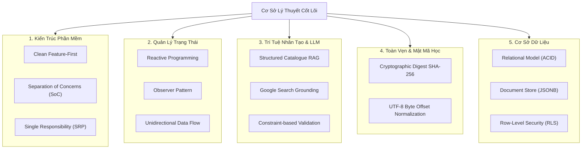
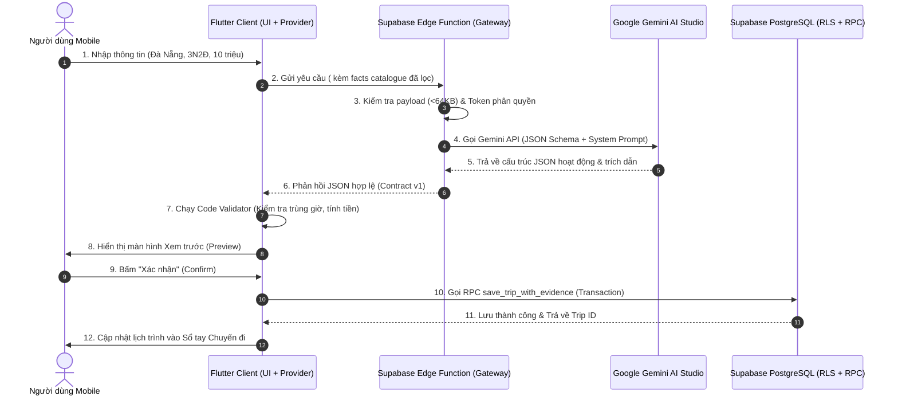
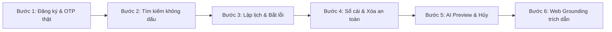

# GIÁO TRÌNH TOÀN DIỆN 7 TRỤ CỘT BẢO VỆ ĐỒ ÁN TRAVELGO
> **Dự án:** Ứng dụng Di động Lập Kế hoạch Du lịch Thông minh TravelGO  
> **Phiên bản:** Hoàn thiện nghiệm thu (Mốc C1–C7, A1–A5, W1–W3, 1.449 Automated Tests PASS)  
> **Mục tiêu:** Giúp nhóm làm chủ từ lý thuyết nền tảng đến thực thi kỹ thuật, tự tin thuyết trình và phản biện xuất sắc trước Hội đồng chấm thi.

---

## MỤC LỤC 7 TRỤ CỘT KIẾN THỨC

1. [Trụ cột 1: Mô Tả Bài Toán (Problem Statement)](#trụ-cột-1-mô-tả-bài-toán-problem-statement)
2. [Trụ cột 2: Cơ Sở Lý Thuyết (Theoretical Foundations)](#trụ-cột-2-cơ-sở-lý-thuyết-theoretical-foundations)
3. [Trụ cột 3: Công Nghệ Sử Dụng Cho Từng Chức Năng (Tech Stack Mapping)](#trụ-cột-3-công-nghệ-sử-dụng-cho-từng-chức-năng-tech-stack-mapping)
4. [Trụ cột 4: Luồng Hoạt Động Tổng & Riêng (System & Module Workflows)](#trụ-cột-4-luồng-hoạt-động-tổng--riêng-system--module-workflows)
5. [Trụ cột 5: Phân Tích Công Nghệ Thay Thế & Lý Do Lựa Chọn (Alternative Tech & Trade-offs)](#trụ-cột-5-phân-tích-công-nghệ-thay-thế--lý-do-lựa-chọn-alternative-tech--trade-offs)
6. [Trụ cột 6: Kịch Bản Demo Thực Nghiệm Chuẩn Xác (Live Demo Script)](#trụ-cột-6-kịch-bản-demo-thực-nghiệm-chuẩn-xác-live-demo-script)
7. [Trụ cột 7: Lỗi Đang Gặp, Nợ Kỹ Thuật & Hướng Phát Triển Tương Lai (Limitations & Future Work)](#trụ-cột-7-lỗi-đang-gặp-nợ-kỹ-thuật--hướng-phát-triển-tương-lai-limitations--future-work)

---

## TRỤ CỘT 1: MÔ TẢ BÀI TOÁN (PROBLEM STATEMENT)

### 1.1. Bối cảnh thực tế
- Xu hướng du lịch tự túc (Free & Independent Traveler - FIT) tại Việt Nam bùng nổ mạnh mẽ trong giới trẻ.
- Tuy nhiên, người đi du lịch tự túc gặp phải **"Nghịch lý của sự lựa chọn" (Paradox of Choice)**:
  - Thông tin điểm đến phân mảnh rải rác trên mạng xã hội, diễn đàn, bài review không rõ nguồn gốc.
  - Rất khó để sắp xếp các hoạt động trong ngày sao cho hợp lý về mặt thời gian (tránh việc địa điểm đóng cửa hoặc bị trùng giờ).
  - Chi phí du lịch thường xuyên bị đội vốn do không có công cụ hạch toán minh bạch giữa ngân sách dự trù ban đầu và chi tiêu thực tế.

### 1.2. Chân dung người dùng mục tiêu (Persona)
- **Tên:** Minh (25 tuổi, kỹ sư CNTT tại TP. Hồ Chí Minh).
- **Đặc điểm:** Bận rộn, thích đi du lịch 2–4 ngày vào cuối tuần hoặc lễ ngắn ngày, đi cùng nhóm bạn 3–4 người.
- **Ngân sách:** 3.000.000 – 5.000.000 VNĐ / người.
- **Nhu cầu cốt lõi:** Cần một công cụ giúp trả lời bài toán: *"Với ngân sách X triệu, đi từ Y trong Z ngày thì nên đi đâu, lịch trình sắp xếp ra sao để không quá tải và chi phí không bị vượt trần?"*

### 1.3. Mục tiêu và Giải pháp của TravelGO
- **Tránh "bẫy chatbot văn bản":** Không xây dựng chatbot tán gẫu tự do vô bổ.
- **Tập trung vào trải nghiệm xúc giác & tương tác cao:**
  1. Cho phép người dùng tự thiết kế lịch trình kéo thả mượt mà trên Timeline.
  2. Hạch toán tài chính 3 cột độc lập và minh bạch (Ngân sách - Dự toán - Thực chi).
  3. Tích hợp **Trợ lý AI lập lịch trình có căn cứ (Grounded AI Assistant)**: AI chỉ đóng vai trò đề xuất dựa trên dữ liệu thật, kiểm tra bằng code xác định, và người dùng luôn có toàn quyền phê duyệt (Human-in-the-Loop).

---

## TRỤ CỘT 2: CƠ SỞ LÝ THUYẾT (THEORETICAL FOUNDATIONS)

Để trả lời thuyết phục trước các câu hỏi học thuật của Thầy Cô, nhóm cần nắm vững 5 cơ sở lý thuyết sau:

### 2.1. Lý thuyết Kiến trúc Phần mềm (Software Architecture)
- **Clean Architecture & Feature-First:** Phân chia mã nguồn theo miền nghiệp vụ độc lập (Auth, Explore, Trip Planner, Trips, Admin). Đảm bảo tính liên kết cao (High Cohesion) và phụ thuộc lỏng (Low Coupling).
- **Separation of Concerns (SoC) & SRP:** Tách bạch tuyệt đối giữa Giao diện hiển thị (UI Widget), Quản lý trạng thái (Provider), và Xử lý logic thuần túy (Service / Validator / Codec).

### 2.2. Lý thuyết Quản lý Trạng thái (Reactive State Management)
- Dựa trên **Observer Pattern**: State (`ChangeNotifier`) đóng vai trò Subject, các Widget lắng nghe đóng vai trò Observer.
- **Unidirectional Data Flow (Luồng dữ liệu một chiều):**
  $$\text{User Action} \longrightarrow \text{Provider Method} \longrightarrow \text{Mutate State} \longrightarrow \text{notifyListeners()} \longrightarrow \text{UI Re-render}$$
  Giúp trạng thái ứng dụng luôn nhất quán, dễ debug và dễ viết unit test.

### 2.3. Lý thuyết RAG & Trí tuệ nhân tạo (Structured RAG & Grounding)
- **RAG (Retrieval-Augmented Generation):** Cung cấp dữ liệu thực tế (Facts) vào prompt trước khi gọi LLM nhằm triệt tiêu hiện tượng ảo giác (Hallucination).
- **Structured RAG vs Semantic Vector RAG:** Với dữ liệu danh mục có cấu trúc (JSON Metadata), kỹ thuật lọc chính xác (Exact Filtering) đem lại độ tin cậy $100\%$, vượt trội so với tìm kiếm xấp xỉ xác suất (Cosine Similarity qua Vector Database).
- **Google Search Grounding:** Tích hợp tìm kiếm web thời gian thực để mở rộng tri thức cho các thực thể ngoài danh mục, kèm chỉ số trích dẫn nguồn (Citations).

### 2.4. Lý thuyết Toàn vẹn Dữ liệu & Mật mã học (Data Integrity & Hashing)
- **Hàm băm một chiều (Cryptographic Hash SHA-256):** 
  - Ứng dụng trong việc đóng băng bản phát hành Admin (C7 Publication Freeze).
  - Ứng dụng trong việc tạo mã băm chứng thực phong bì dữ liệu (`TripEvidenceCodec.digest()`), giúp phát hiện ngay lập tức bất kỳ sự giả mạo dữ liệu nào.
- **Mã hóa ký tự UTF-8 (Byte Offset vs Character Length):** 
  - Ký tự tiếng Việt đa byte chiếm 2–3 bytes. Xử lý chuẩn hóa theo mốc byte nhị phân để đảm bảo tính đúng đắn khi trích xuất đoạn văn bản dẫn chứng.

### 2.5. Lý thuyết Cơ sở dữ liệu (Database Design)
- **Hybrid Relational-Document Model:** Kết hợp tính toàn vẹn quan hệ (ACID, Foreign Keys) của PostgreSQL với tính linh hoạt của tài liệu cây phân cấp (PostgreSQL `JSONB`).
- **Row-Level Security (RLS):** Kiểm soát phân quyền dựa trên định danh người dùng `auth.uid()` ngay tại tầng động cơ cơ sở dữ liệu.

---

## TRỤ CỘT 3: CÔNG NGHỆ SỬ DỤNG CHO TỪNG CHỨC NĂNG (TECH STACK MAPPING)

| Phân hệ / Chức năng | Công nghệ / Thư viện chính | Vai trò kỹ thuật chi tiết |
| :--- | :--- | :--- |
| **Mobile Client UI** | **Flutter 3.x / Dart 3.x** | Xây dựng giao diện đa nền tảng, cơ chế vẽ Canvas Skia/Impeller native 60 FPS, hệ thống Design Tokens nhất quán. |
| **Quản lý Trạng thái** | `provider: ^6.1.5+1` | Quản lý vòng đời trạng thái màn hình (`ChangeNotifier`), tối ưu rebuild bằng `context.select()`. |
| **Tầng Mạng & HTTP** | `dio: ^5.11.1` | Xử lý REST API, cấu hình Interceptor ghi log debug, cơ chế Timeout chặt chẽ (15s connect, 30s receive), xử lý lỗi mạng an toàn. |
| **Xác thực & Người dùng** | **Supabase Auth** | Xác thực Email OTP 6 số thực tế, quản lý JWT token, lưu trữ phiên làm việc an toàn trên thiết bị (`local_account_lifecycle_service.dart`). |
| **Cơ sở dữ liệu chính** | **PostgreSQL 15 (Supabase)** | Lưu trữ quan hệ, quản lý bảo mật từng dòng qua Row Level Security (RLS), lưu trữ cây lịch trình dưới dạng `JSONB`. |
| **Thủ tục lưu trữ nguyên tử** | **PostgreSQL RPC** | Hàm `save_trip_with_evidence`: thực hiện transaction ACID lưu chuyến đi, cập nhật sổ cái và phong bì bằng chứng. |
| **API Gateway Backend** | **Supabase Edge Functions** (Deno runtime) | Trung gian xử lý bảo mật: `admin-control`, `admin-publication`, `itinerary-proposal`. Kiểm soát payload giới hạn 64KB, timeout 5s. |
| **Trí tuệ Nhân tạo (LLM)** | **Google Gemini 2.5 Flash Lite** | Mô hình ngôn ngữ phản hồi siêu nhanh, hỗ trợ JSON Mode nghiêm ngặt theo hợp đồng `travelgo.itinerary.v1`. |
| **Trích dẫn Tri thức Web** | **Google Search Grounding** | Mở rộng tìm kiếm các điểm đến ngoài danh mục Admin (W1–W3), trả về siêu dữ liệu trích dẫn nguồn web. |
| **Trực quan hóa Dữ liệu** | `fl_chart: ^1.2.0` | Vẽ biểu đồ ngân sách (Donut Chart) phản hồi thời gian thực trên thiết bị di động. |
| **Kiểm thử Tự động** | `flutter_test`, `node --test` | 1.257 bài test Flutter client và 192 bài test hợp đồng Node.js backend. |

---

## TRỤ CỘT 4: LUỒNG HOẠT ĐỘNG TỔNG & RIÊNG (SYSTEM & MODULE WORKFLOWS)

### 4.1. Sơ đồ Kiến trúc Hoạt động Tổng thể (End-to-End System Flow)

---

### 4.2. Luồng hoạt động chi tiết của từng Phân hệ riêng

#### A. Luồng Xác thực & Bảo vệ Phiên làm việc (Auth Flow):
1. Người dùng nhập Email $\rightarrow$ `AuthProvider` gọi `SupabaseClient.auth.signUp()`.
2. Supabase gửi mã OTP thực về Email. Client kích hoạt đồng hồ đếm ngược 60 giây chống spam.
3. Người dùng nhập 6 số $\rightarrow$ Xác thực thành công $\rightarrow$ Nhận JWT Session Token.
4. Token được kiểm tra quyền: Nếu là Quản trị viên $\rightarrow$ Điều hướng sang `AdminShellScreen`; Nếu là Khách hàng $\rightarrow$ Điều hướng sang `MainNavigationShell`.
5. Đăng xuất: Kích hoạt `_authEpoch++`, xóa token và giải phóng toàn bộ dữ liệu nhớ tạm.

#### B. Luồng Khám phá & Đồng bộ Danh mục (Explore & Sync Coordinator):
1. Khi app mở, `CatalogueSyncCoordinator` đọc mã băm SHA-256 của danh mục đang lưu trong máy.
2. Gửi mã hash lên Supabase để kiểm tra xem Admin có phát hành phiên bản mới (`public_catalogue_snapshot`) không.
3. Nếu có bản mới $\rightarrow$ Tải danh mục mới về lưu vào `PublicCatalogueCache`.
4. Tìm kiếm địa điểm: Người dùng gõ từ khóa $\rightarrow$ Chuẩn hóa không dấu bằng `removeDiacritics()` $\rightarrow$ Lọc trực tiếp trên Cache với tốc độ realtime.

#### C. Luồng Lập lịch Thủ công & Kiểm định Lịch trình (Manual Planner & Validator):
1. Người dùng chọn ngày $\rightarrow$ `EditableTripMutator` khởi tạo danh sách `TripDay`.
2. Người dùng thêm một hoạt động $\rightarrow$ Chọn giờ bắt đầu và kết thúc (chuyển đổi thành số phút trong ngày: `startMinute`, `endMinute`).
3. Bộ kiểm định [`EditableTripValidator`](file:///d:/Travel-Go-Android/travel-go/lib/features/trip_planner/services/editable_trip_validator.dart) kích hoạt ngay tại Client:
   - Kiểm tra `endMinute > startMinute`.
   - Kiểm tra trùng giờ: $(A.\text{start} < B.\text{end}) \land (B.\text{start} < A.\text{end})$.
   - Nếu trùng giờ $\rightarrow$ Hiển thị cảnh báo lỗi màu vàng/đỏ. Người dùng có quyền nhập lý do ngoại lệ để bỏ qua lỗi (`issueFingerprint`).

#### D. Luồng Hạch toán Sổ Cái Tài Chính 3 Cột (Budget Ledger Flow):
1. Người dùng thiết lập ngân sách định mức ban đầu: `budgetVnd`.
2. Khi thêm/sửa hoạt động, [`BudgetCalculator`](file:///d:/Travel-Go-Android/travel-go/lib/features/trip_planner/services/budget_calculator.dart) tính toán tổng dự toán:
   $$\text{knownEstimate} = \sum (\text{unitAmountVnd} \times \text{multiplier})$$
   *(Trong đó hệ số `multiplier` tự động nhân theo số người hoặc số ngày tương ứng).*
3. Người dùng nhập các khoản tiền thực chi khi đi du lịch: `actualExpenses`.
4. Hệ thống dùng kiểu số nguyên lớn `BigInt` để chống tràn số, tự động tính toán số dư:
   $$\text{estimateRemaining} = \text{budgetVnd} - \text{knownEstimate}$$
   $$\text{actualRemaining} = \text{budgetVnd} - \text{actualTotal}$$
5. Khi xóa một hoạt động khỏi lịch trình: Khoản tiền thực chi liên quan được giữ nguyên, chuyển sang dạng lưu vết `ItemSnapshot`.

#### E. Luồng Trợ lý AI Lập lịch & Google Grounding (AI Planner Flow):
1. Người dùng mở mục AI, chọn điểm đến, ngân sách và sở thích.
2. Kiểm tra danh mục Admin:
   - **Trường hợp 1 (Có trong danh mục):** Trích xuất danh sách địa danh đã kiểm duyệt $\rightarrow$ Đóng gói thành `facts` $\rightarrow$ Nạp vào Gemini.
   - **Trường hợp 2 (Ngoài danh mục, ví dụ: Côn Đảo):** Hệ thống hỏi người dùng có muốn tìm web không $\rightarrow$ Nếu đồng ý $\rightarrow$ Gọi Gemini kèm công cụ **Google Search Grounding**.
3. Kết quả Grounding được chuẩn hóa qua hàm `sliceUtf8Bytes` (xử lý byte offset tiếng Việt), lưu các địa điểm mới vào mảng `externalPlaces` với `placeId: null`.
4. Kết quả hiển thị qua màn hình **Xem trước (Preview)**:
   - Bấm **Hủy (Cancel):** Giữ nguyên 100% tài liệu cũ.
   - Bấm **Xác nhận (Confirm):** Áp dụng các thay đổi vào trình biên tập.

#### F. Luồng Quản trị Danh mục & Xuất bản (Admin Publication C7):
1. Admin tạo/sửa thông tin địa điểm trong bảng `draft_history`.
2. Admin bấm "Đóng băng phiên bản": Hệ thống tính toán mã băm SHA-256 của toàn bộ danh mục để khóa dữ liệu.
3. Admin bấm "Phát hành": Dữ liệu được đẩy lên bảng công khai cho toàn bộ người dùng.

---

## TRỤ CỘT 5: PHÂN TÍCH CÔNG NGHỆ THAY THẾ & LÝ DO LỰA CHỌN (ALTERNATIVE TECH & TRADE-OFFS)

Khi bảo vệ đồ án, Thầy Cô rất hay hỏi: *"Tại sao em dùng công nghệ A mà không dùng công nghệ B?"*. Dưới đây là bảng so sánh chuẩn học thuật:

### 5.1. Mobile Client: Flutter vs React Native vs Native Android (Kotlin)
| Tiêu chí | Flutter (TravelGO chọn) | React Native | Native Android (Kotlin) |
| :--- | :--- | :--- | :--- |
| **Cơ chế hiển thị** | Vẽ trực tiếp qua Canvas (Skia/Impeller), không qua cầu nối. | Dùng JavaScript Bridge ánh xạ sang Native Components. | Render trực tiếp bằng View/Jetpack Compose của Android. |
| **Độ mượt (FPS)** | 60–120 FPS ổn định, không giật lag. | Có thể bị drop frame khi cầu nối JS bị nghẽn. | Cực kỳ mượt mà. |
| **Đa nền tảng** | 1 Codebase chạy mượt cả Android và iOS. | 1 Codebase nhưng hay bị lỗi khác biệt giữa 2 hệ điều hành. | Chỉ chạy Android; muốn làm iOS phải viết lại bằng Swift. |
| **Lý do chọn:** | **Flutter giúp nhóm phát triển giao diện Timeline xúc giác phức tạp với hiệu năng native, mã nguồn nhất quán bằng ngôn ngữ tĩnh Dart (Type-safe), dễ viết automated test.** |

---

### 5.2. Quản lý Trạng thái: Provider vs BLoC vs Riverpod
| Tiêu chí | Provider (TravelGO chọn) | BLoC | Riverpod |
| :--- | :--- | :--- | :--- |
| **Độ phức tạp mã nguồn** | Đơn giản, ngắn gọn, trực quan. | Rất nhiều boilerplate (Event, State, BlocBuilder). | Cần làm quen với cú pháp ProviderScope toàn cục. |
| **Khả năng kiểm thử** | Dễ dàng mock và inject qua constructor. | Dễ kiểm thử luồng Stream. | Dễ kiểm thử. |
| **Phù hợp dự án** | Hoàn hảo cho ứng dụng lập lịch trình tương tác cao. | Phù hợp dự án quy mô ngân hàng/doanh nghiệp lớn. | Mạnh mẽ nhưng chi phí học tập cao. |
| **Lý do chọn:** | **Provider đáp ứng 100% nhu cầu quản lý trạng thái phản ứng (Reactive), tối ưu rebuild tốt bằng `context.select()`, giúp nhóm tập trung viết 1.257 bài test nghiệp vụ thay vì tốn thời gian cho mã boilerplate của BLoC.** |

---

### 5.3. Backend & Cơ sở dữ liệu: Supabase vs Firebase vs Tự viết Spring Boot/Node.js
| Tiêu chí | Supabase (TravelGO chọn) | Firebase | Tự viết Spring Boot / Express |
| :--- | :--- | :--- | :--- |
| **Mô hình Dữ liệu** | **PostgreSQL (Quan hệ + JSONB)**. | Firestore (NoSQL Document). | Tùy chọn (MySQL, Postgres...). |
| **Ràng buộc toàn vẹn** | Hỗ trợ ACID, Khóa ngoại, Transaction chặt chẽ. | NoSQL không có khóa ngoại, dễ trùng lặp dữ liệu. | Tự thiết kế và cấu hình. |
| **Bảo mật phân quyền** | **Row Level Security (RLS)** native trên database. | Firebase Security Rules (khó debug). | Tự viết Middleware, Spring Security, JWT. |
| **Thời gian triển khai** | Rất nhanh (có sẵn Auth, RPC, Storage, Edge Functions). | Rất nhanh. | Rất lâu (tốn hàng trăm giờ làm CRUD cơ bản). |
| **Lý do chọn:** | **TravelGO quản lý lịch trình và tài chính nên bắt buộc phải có tính toàn vẹn quan hệ (ACID) của PostgreSQL. Supabase cung cấp BaaS mạnh mẽ giúp nhóm tiết kiệm hạ tầng, tận dụng RLS để bảo vệ dữ liệu người dùng tuyệt đối.** |

---

### 5.4. Trí tuệ Nhân tạo: Structured Catalogue RAG vs Vector Database (Pinecone/Milvus)
| Tiêu chí | Structured RAG (TravelGO chọn) | Vector Database + LangChain |
| :--- | :--- | :--- |
| **Bản chất dữ liệu** | Dữ liệu danh mục du lịch đã có cấu trúc (Metadata: điểm đến, giờ mở, giá). | Văn bản tự do không cấu trúc (sách báo, tài liệu PDF). |
| **Cơ chế truy xuất** | **Exact Metadata Filtering** (Lọc chính xác theo Destination ID). | K-Nearest Neighbors (KNN) dựa trên khoảng cách Cosine. |
| **Độ chính xác** | **100% chính xác**, không bao giờ nhầm địa danh khác vùng miền. | Xác suất thống kê, có thể bị trôi ngữ nghĩa (Semantic Drift). |
| **Độ trễ & Chi phí** | Phản hồi dưới 500ms, chi phí hạ tầng = 0 VNĐ. | Độ trễ cao (Embedding + Search), tốn phí máy chủ Vector DB. |
| **Lý do chọn:** | **Dữ liệu du lịch của ứng dụng đã được Admin chuẩn hóa cấu trúc. Việc dựng Vector DB cồng kềnh là Over-engineering (thừa thãi kỹ thuật) và làm chậm ứng dụng.** |

---

## TRỤ CỘT 6: KỊCH BẢN DEMO THỰC NGHIỆM CHUẨN XÁC (LIVE DEMO SCRIPT)

Khi bước vào phần Demo trước Hội đồng, hãy thực hiện theo đúng **6 bước kịch bản vàng** sau:

### Bước 1: Trình diễn Xác thực & Chế độ Khách (Auth & Guest Mode)
- **Thao tác:**
  1. Mở app, bấm "Dùng thử không cần đăng nhập" (Guest Mode).
  2. Tạo thử một chuyến đi nháp, bấm "Lưu vào tài khoản" $\rightarrow$ App chặn lại, hiển thị thông báo yêu cầu đăng nhập.
  3. Bấm Đăng ký, nhập Email thật.
  4. Mở hộp thư Email lấy mã OTP 6 số, nhập vào `OtpVerificationScreen`.
- **Thuyết minh với Thầy:** *"Hệ thống sử dụng dịch vụ xác thực Supabase Auth với OTP thật qua hòm thư điện tử, có đồng hồ đếm ngược 60 giây chống spam và bảo vệ dữ liệu người dùng qua JWT Session."*

### Bước 2: Khám phá & Tìm kiếm tiếng Việt không dấu (Explore Search)
- **Thao tác:**
  1. Vào màn hình Khám phá.
  2. Gõ từ khóa không dấu: `da nang` hoặc `nha trang`.
  3. Bấm vào một địa danh (ví dụ: Bà Nà Hills), chỉ cho Thầy thấy: Giờ mở cửa, Giá vé tham khảo và Nguồn xác minh thông tin.
- **Thuyết minh với Thầy:** *"Hệ thống áp dụng thuật toán chuẩn hóa chuỗi `removeDiacritics()`, lọc dữ liệu trực tiếp trên Cache cục bộ nên tốc độ tìm kiếm hiển thị tức thì theo từng ký tự gõ phím."*

### Bước 3: Lập lịch trình & Kích hoạt Kiểm định Lỗi (Manual Planner & Validation)
- **Thao tác:**
  1. Tạo chuyến đi: "Du lịch Đà Nẵng 3N2Đ", hạn mức ngân sách 10.000.000 VNĐ.
  2. Thêm Hoạt động 1: `08:00 - 11:30` (Bà Nà Hills).
  3. Cố tình thêm Hoạt động 2 bị trùng giờ: `10:00 - 12:00` (Bảo tàng Chăm).
  4. Chỉ cho Thầy thấy: Ứng dụng lập tức báo vạch đỏ cảnh báo trùng giờ!
  5. Bấm vào cảnh báo, nhập lý do: "Nhóm tách đôi đi riêng" $\rightarrow$ Lỗi chuyển sang trạng thái đã ghi nhận (`acknowledged`) và cho phép lưu.
- **Thuyết minh với Thầy:** *"Đây là bộ kiểm định `EditableTripValidator` chạy bằng thuật toán xác định trên máy khách. Hệ thống tự động bắt lỗi trùng giờ và hỗ trợ cơ chế lưu vết ngoại lệ `issueFingerprint`."*

### Bước 4: Sổ cái Tài chính 3 Cột & Xóa hoạt động an toàn (Financial Ledger)
- **Thao tác:**
  1. Mở tab Ngân sách: Chỉ rõ 3 cột (Ngân sách định mức, Dự toán kế hoạch, Thực tế đã chi).
  2. Nhập một khoản chi thực tế: "Tiền vé cáp treo Bà Nà: 950.000 VNĐ" (gắn với hoạt động Bà Nà Hills).
  3. Quay lại lịch trình, thực hiện **XÓA hoạt động Bà Nà Hills**.
  4. Quay lại tab Ngân sách: Khoản tiền 950.000 VNĐ **vẫn còn nguyên vẹn trong sổ cái** và tự động mang nhãn ghi nhớ `ItemSnapshot`!
- **Thuyết minh với Thầy:** *"Ứng dụng tuân thủ nguyên tắc kế toán tài chính: Xóa hoạt động khỏi lịch không bao giờ làm mất các khoản tiền người dùng đã thực chi, bảo vệ toàn vẹn lịch sử chi tiêu."*

### Bước 5: Trợ lý AI Sinh Lịch Trình & Luật 1 (Preview & Cancel)
- **Thao tác:**
  1. Mở một bản nháp trống, bấm "AI tạo lịch trình".
  2. Nhập: Điểm đến "Đà Nẵng", 3 ngày, 3 người, ngân sách 15 triệu.
  3. Chờ 2-3 giây, màn hình **Xem trước (Preview)** hiện ra với đầy đủ các hoạt động đã được phân bổ giờ.
  4. **Bấm nút HỦY (Cancel)**: Toàn bộ bản nháp giữ nguyên trạng thái cũ.
  5. Bấm tạo lại và bấm **XÁC NHẬN (Confirm)**: Lịch trình nạp vào trình biên tập để người dùng tiếp tục sửa tay.
- **Thuyết minh với Thầy:** *"Ứng dụng tuân thủ nghiêm ngặt Luật 1: Quyền kiểm soát thuộc về người dùng (Human-in-the-Loop). Mọi gợi ý AI bắt buộc qua Xem trước; bấm Hủy giữ nguyên 100% dữ liệu gốc."*

### Bước 6: Mở rộng Tìm kiếm Web Google Grounding (Web Evidence)
- **Thao tác:**
  1. Nhập một điểm đến nằm ngoài danh mục hệ thống: Ví dụ "Phú Quý" hoặc "Côn Đảo".
  2. App thông báo điểm đến chưa có trong danh mục nội bộ và hỏi: *"Bạn có muốn tìm kiếm thông tin trên Internet không?"*.
  3. Bấm Đồng ý $\rightarrow$ Gemini kích hoạt Google Search Grounding.
  4. Mở xem chi tiết địa điểm được tạo ra: Chỉ cho Thầy thấy nhãn cảnh báo: *"Thông tin từ Internet, chưa được Admin kiểm duyệt"* và các đường link nguồn trích dẫn.
- **Thuyết minh với Thầy:** *"Với điểm đến ngoài danh mục, hệ thống sử dụng Google Search Grounding, chuẩn hóa trích dẫn bằng bộ cắt UTF-8 Byte Offset và lưu vào mảng `externalPlaces` với `placeId: null` để không làm ô nhiễm cơ sở dữ liệu của Admin."*

---

## TRỤ CỘT 7: LỖI ĐANG GẶP, NỢ KỸ THUẬT & HƯỚNG PHÁT TRIỂN TƯƠNG LAI (LIMITATIONS & FUTURE WORK)

Một kỹ sư phần mềm giỏi luôn biết rõ giới hạn sản phẩm của mình:

### 7.1. Các nợ kỹ thuật đã chấp nhận (Accepted Technical Debt)
1. **ISSUE-001 (Dữ liệu Fallback ngoại tuyến cứng trong Service):**
   - *Hiện trạng:* Khi thiết bị mất mạng hoàn toàn và chưa từng tải dữ liệu, hệ thống trả về bộ dữ liệu fallback mẫu cứng trong `trip_api_service.dart`.
   - *Lý do chấp nhận:* Giúp ứng dụng không bị crash trắng màn hình trong môi trường thử nghiệm khi chưa cấu hình máy chủ offline.
2. **ISSUE-002 (Cấu hình mẫu Preset tĩnh trong Model):**
   - *Hiện trạng:* Một số chuyến đi mẫu (Minh, Phú Quốc, Vũng Tàu) được định nghĩa sẵn trong `trip_request.dart` để phục vụ demo nhanh bằng 1 nút bấm.
3. **ISSUE-003 (Chưa có cơ sở dữ liệu SQLite/Isar lưu trữ ngoại tuyến hoàn toàn):**
   - *Hiện trạng:* Ứng dụng hiện lưu cache in-memory và `SharedPreferences`. Nếu người dùng mất mạng trong rừng sâu và tắt hẳn ứng dụng, họ chưa thể tạo mới một chuyến đi offline hoàn chỉnh rồi tự động sync lại khi có mạng.

### 7.2. Các lỗi / Thách thức đang gặp phải
- **Hạn mức Quota API Gemini:** Khi sử dụng Google Search Grounding liên tục trong thời gian ngắn, có thể chạm giới hạn Rate Limit (RPM/TPM) của gói thử nghiệm Google AI Studio. Giải pháp hiện tại là hiển thị thông báo lỗi rõ ràng và cung cấp nút thử lại.
- **Thời gian gửi OTP qua Email:** Tùy thuộc vào nhà cung cấp dịch vụ thư (Google/Supabase Mail), đôi khi email OTP có độ trễ 5–10 giây. Hệ thống đã khắc phục bằng đồng hồ đếm ngược 60s để người dùng kiên nhẫn chờ.

### 7.3. Hướng phát triển tương lai (Future Roadmap)
1. **Kiến trúc Ngoại tuyến Toàn diện (Offline-First Architecture):**
   - Tích hợp Local Database (Drift hoặc Isar) trên thiết bị di động.
   - Triển khai cơ chế Đồng bộ 2 chiều (Bidirectional Sync) với thuật toán giải quyết xung đột (Conflict Resolution CRDT), cho phép người dùng đi vào vùng mất sóng vẫn sửa lịch bình thường.
2. **Mở rộng Danh mục Admin 63 Tỉnh Thành:**
   - Xây dựng cổng thông tin để các đơn vị xúc tiến du lịch địa phương tự đóng góp dữ liệu, mở rộng danh mục Admin nhằm giảm bớt tần suất phải gọi tìm kiếm web Google Grounding.
3. **Mô hình AI Đa phương thức (Multimodal AI):**
   - Cho phép người dùng chụp ảnh hóa đơn thanh toán thực tế (vé máy bay, hóa đơn nhà hàng) $\rightarrow$ Dùng Gemini Vision tự động trích xuất số tiền và nạp thẳng vào Sổ cái chi tiêu `actualExpenses`.

