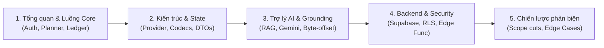

# CẨM NANG ÔN TẬP VÀ TRẢ LỜI VẤN ĐÁP BẢO VỆ ĐỒ ÁN TRAVELGO
> **Dành cho:** Toàn bộ thành viên nhóm bảo vệ đồ án môn học / Khóa luận tốt nghiệp  
> **Dự án:** Ứng dụng Di động Lập kế hoạch Du lịch Thông minh TravelGO  
> **Công nghệ:** Flutter (Dart), Supabase (PostgreSQL, Edge Functions, Auth), Gemini AI (Search Grounding)

---

## MỤC LỤC TỔNG QUAN

1. [Phần 1: Lộ Trình 5 Khối Kiến Thức Cốt Lõi Phải Nắm](#phần-1-lộ-trình-5-khối-kiến-thức-cốt-lõi-phải-nắm)
2. [Phần 2: Tóm Tắt Ý Chính Theo Từng Module](#phần-2-tóm-tắt-ý-chính-theo-từng-module)
3. [Phần 3: 4 Nguyên Tắc Kiến Trúc "Bất Biến" (4 Architectural Laws)](#phần-3-4-nguyên-tắc-kiến-trúc-bất-biến-4-architectural-laws)
4. [Phần 4: Bộ Câu Hỏi "Hỏi Xoáy - Đáp Chuẩn" Của Giảng Viên](#phần-4-bộ-câu-hỏi-hỏi-xoáy---đáp-chuẩn-của-giảng-viên)
   - [Chủ đề A: Kiến trúc phần mềm & Flutter Framework](#chủ-đề-a-kiến-trúc-phần-mềm--flutter-framework)
   - [Chủ đề B: Trí tuệ nhân tạo (AI), RAG & Google Grounding](#chủ-đề-b-trí-tuệ-nhân-tạo-ai-rag--google-grounding)
   - [Chủ đề C: Backend, Supabase, Phân quyền & Cơ sở dữ liệu](#chủ-đề-c-backend-supabase-phân-quyền--cơ-sở-dữ-liệu)
   - [Chủ đề D: Xử lý Bất đồng bộ, Dữ liệu ngoại tuyến & Toàn vẹn thông tin](#chủ-đề-d-xử-lý-bất-đồng-bộ-dữ-liệu-ngoại-tuyến--toàn-vẹn-thông-tin)
   - [Chủ đề E: Phạm vi sản phẩm & Quyết định kỹ thuật (Scope & Trade-offs)](#chủ-đề-e-phạm-vi-sản-phẩm--quyết-định-kỹ-thuật-scope--trade-offs)
5. [Phần 5: Checklist Tự Tin Trước Giờ Lên Bảng](#phần-5-checklist-tự-tin-trước-giờ-lên-bảng)

---

## PHẦN 1: LỘ TRÌNH 5 KHỐI KIẾN THỨC CỐT LÕI PHẢI NẮM

Để không bị ngợp, hãy chia việc ôn tập thành 5 buổi/chặng:

1. **Khối 1: Nghiệp vụ và Luồng sản phẩm (User Journey):** Đi từ lúc đăng ký OTP, duyệt danh mục điểm đến, tự lập lịch hoặc nhờ AI sinh lịch, chỉnh sửa chi tiêu 3 cột, lưu và mở lại chuyến đi.
2. **Khối 2: Kiến trúc Client Flutter & Quản lý trạng thái:** Hiểu rõ Clean Feature Architecture, Provider pattern, tại sao không dùng Bloc, xử lý rebuild tối ưu.
3. **Khối 3: Trí tuệ nhân tạo (AI Engine):** Nắm chắc 3 chế độ (Generate, Advice, Modify), cơ chế RAG đơn giản lọc catalogue, Google Search Grounding và xử lý UTF-8 Byte Offset.
4. **Khối 4: Backend & Bảo mật (Supabase):** Nắm RLS (Row Level Security), phân quyền Admin vs Customer, Edge Functions Gateway và quy trình xuất bản dữ liệu Admin (SHA-256).
5. **Khối 5: Các quyết định loại bỏ tính năng (Trade-offs):** Lý giải tại sao bỏ bản đồ/GPS, bỏ mô hình đa tiêu chí MCDA/Pareto phức tạp, bỏ chatbot tổng quát để tập trung vào tính ổn định.

---

## PHẦN 2: TÓM TẮT Ý CHÍNH THEO TỪNG MODULE

### 1. Phân hệ Xác thực & Quản lý Tài khoản (Auth & Profile)
- **Công nghệ:** Supabase Auth qua Email OTP thực tế (không dùng OTP giả lập).
- **Điểm kỹ thuật cao:**
  - Token được quản lý qua [AuthProvider](file:///d:/Travel-Go-Android/travel-go/lib/features/auth/providers/auth_provider.dart) kết hợp chu trình sống của ứng dụng (`AppLifecycleState`).
  - Hỗ trợ chế độ Guest (khách xem thử), nhưng khi thao tác dữ liệu riêng tư (lưu chuyến đi) sẽ yêu cầu đăng nhập.
  - Xử lý triệt để việc cô lập tài khoản: Đăng xuất xóa sạch dữ liệu nhớ tạm, không để tài khoản sau nhìn thấy bản nháp của tài khoản trước.

### 2. Phân hệ Khám phá & Danh mục Địa điểm (Explore & Catalogue)
- **Cấu trúc dữ liệu:** Điểm đến (`destinations`) và Địa danh tham quan (`discovery_places`).
- **Phân cấp nguồn:** Có nguồn trích dẫn rõ ràng, giờ mở cửa và chi phí tham khảo. Nếu chưa có thông tin chính thức, dữ liệu giữ giá trị `null` và nhãn `unverified` (chưa xác minh), không tự bịa giá 0 VNĐ.

### 3. Phân hệ Lập Kế hoạch Thủ công & Sổ Cái Chi Tiêu (Manual Planner & Money Ledger)
- **Cấu trúc lịch trình:** Chuyến đi đa ngày $\rightarrow$ Các hoạt động theo mốc giờ $\rightarrow$ Ghi chú và dự toán.
- **Hạch toán tài chính 3 cột độc lập:**
  1. `budgetVnd`: Hạn mức ngân sách ban đầu do người dùng đặt ra.
  2. `estimatedCostVnd`: Tổng chi phí dự kiến từ các hoạt động trong lịch trình.
  3. `actualExpenses`: Các khoản tiền thực chi người dùng nhập trong hoặc sau chuyến đi.
  *(Hệ thống tự tính toán chênh lệch và cảnh báo vượt ngân sách mà không cần AI hay thuật toán phức tạp).*

### 4. Phân hệ Trợ lý AI Lập Lịch Trình (Grounded AI Assistant)
- **Mô hình:** Gemini 2.5 Flash Lite thông qua Supabase Edge Function (`itinerary-proposal`).
- **3 Năng lực chuyên biệt:**
  - **AI Tạo Lịch (Generation):** Dành cho bản nháp trống. Nhận `destination`, `days`, `budget`, `interests`, lấy địa điểm từ catalogue Admin đưa vào prompt $\rightarrow$ Trả về cấu trúc JSON nghiêm ngặt (`travelgo.itinerary.v1`).
  - **AI Tư vấn (Advice):** Trả lời thắc mắc dựa trên ngữ cảnh lịch hiện tại (ví dụ: "Ngày 2 có dày quá không?"). Trường `operations` luôn rỗng, không làm thay đổi lịch.
  - **AI Đề xuất sửa đổi (Proposal/Modify):** Đề xuất dời giờ, đổi hoạt động khi có xung đột. Sinh ra các `operations` có cấu trúc (thay vì đoạn văn tự do) để Client phân tích và hiển thị so sánh Trước / Sau.
- **Google Search Grounding (Tìm kiếm Web có dẫn nguồn):** Khi điểm đến nằm ngoài catalogue hệ thống (ví dụ: đảo nhỏ, huyện vùng sâu), người dùng chủ động chọn (Opt-in) tìm kiếm Internet.
- **Xử lý UTF-8 Byte Offset:** Chuẩn hóa chỉ số trích dẫn nguồn trên văn bản tiếng Việt có dấu, tránh lỗi vỡ ký tự do khác biệt byte giữa Node.js và Dart.
- **Nguyên tắc cô lập:** Địa điểm tìm từ web lưu trong chuyến đi với `placeId: null` và thuộc danh sách `externalPlaces`, **tuyệt đối không ghi đè hay làm bẩn Danh mục Admin chung**.

### 5. Phân hệ Quản trị Danh mục (Admin Catalogue & Publication Lifecycle - C7)
- **Quy trình xuất bản 3 bước:** Bản nháp (Draft) $\rightarrow$ Đóng băng phiên bản (Freeze & Hash SHA-256) $\rightarrow$ Công bố (Publish).
- **Đồng bộ Client:** Mobile Client có bộ điều phối đồng bộ (Sync Coordinator) cập nhật dữ liệu điểm đến mới nhất từ Admin mà không làm mất ghi chú hay chi tiêu cá nhân của User.

---

## PHẦN 3: 4 NGUYÊN TẮC KIẾN TRÚC "BẤT BIẾN" (4 LAWS)

Khi thầy hỏi về triết lý thiết kế hệ thống, hãy viện dẫn ngay **4 Luật Bất Biến**:

| Luật | Tên gọi | Nội dung cốt lõi | Minh chứng trong Code |
| :--- | :--- | :--- | :--- |
| **Law 1** | **User-in-Control (Quyền kiểm soát thuộc người dùng)** | Mọi kết quả do AI sinh ra bắt buộc phải đi qua màn hình **Xem trước (Preview)**. Thao tác **Hủy (Cancel)** giữ nguyên 100% dữ liệu gốc; chỉ khi bấm **Xác nhận (Confirm)** thì thay đổi mới nạp vào trình biên tập. | `editable_trip_mutator.dart` `ai_generation_service.dart` |
| **Law 2** | **Strict Boundary & Admin Protection (Phân định ranh giới & Bảo vệ dữ liệu)** | Mọi quyền hạn kiểm soát ở Server. Dữ liệu tìm kiếm từ web của User không bao giờ được tự ý chèn vào bảng danh mục Admin (`discovery_places`). | Edge Function `admin-control` `externalPlaces` trong Trip |
| **Law 3** | **Data Truthfulness (Tính trung thực của dữ liệu)** | Không bao giờ giả mạo dữ liệu. Địa điểm chưa rõ giá để `null`, không coi là "miễn phí (0đ)". Dữ liệu từ Internet gắn nhãn cảnh báo: *"Thông tin từ Internet, chưa được Admin kiểm duyệt"*. | `TripEvidenceEnvelope` `money_budget_ui.dart` |
| **Law 4** | **Async Safety & Anti-Data-Loss (Bất đồng bộ an toàn)** | Chống phản hồi muộn (stale response): Nếu người dùng chuyển chuyến đi hoặc sửa tay trong lúc AI đang chạy, kết quả AI trả về sau sẽ bị hủy bỏ, không ghi đè làm mất công sức người dùng. | `_requestGeneration` `auth_epoch` trong Provider |

---

## PHẦN 4: BỘ CÂU HỎI "HỎI XOÁY - ĐÁP CHUẨN" CỦA GIẢNG VIÊN

### Chủ đề A: Kiến trúc phần mềm & Flutter Framework

#### Câu 1: Tại sao nhóm chọn Provider mà không dùng BLoC hay Riverpod? BLoC được coi là chuẩn công nghiệp kia mà?
- **Trả lời chuẩn:**
  > "Dạ thưa Thầy/Cô, việc lựa chọn công nghệ dựa trên sự cân đối giữa quy mô dự án và chi phí bảo trì:
  > 1. **Mức độ phức tạp phù hợp:** TravelGO là ứng dụng di động tập trung vào trải nghiệm lập lịch tương tác cao. `Provider` kết hợp `ChangeNotifier` cung cấp cơ chế Reactive State hoàn toàn đầy đủ, ít mã boilerplate hơn BLoC gấp nhiều lần, giúp nhóm tập trung vào logic nghiệp vụ cốt lõi (xử lý lịch trình, bằng chứng AI, hạch toán tài chính).
  > 2. **Kiểm thử dễ dàng:** Bằng chứng là nhóm đã viết **1.257 bài test tự động** vượt qua 100%, chứng minh Provider hoàn toàn đáp ứng xuất sắc tính khả kiểm (Testability) bằng cách mock service và dependency injection qua constructor.
  > 3. **Tối ưu Rebuild:** Nhóm không lạm dụng `context.watch()` ở widget cha mà tối ưu bằng `context.select()` và các widget con độc lập (`Consumer`) để chỉ render lại đúng vùng dữ liệu thay đổi, đảm bảo hiệu năng 60 FPS."

#### Câu 2: Nhóm tổ chức cấu trúc thư mục theo mô hình gì? Ưu điểm so với Layer-First?
- **Trả lời chuẩn:**
  > "Dạ, nhóm áp dụng kiến trúc **Feature-First (Clean Architecture theo tính năng)**:
  > - Thay vì gom toàn bộ controllers/models/views vào các thư mục dùng chung (Layer-First), nhóm chia theo từng miền nghiệp vụ: `features/auth`, `features/trip_planner`, `features/explore`, `features/admin`.
  > - Trong mỗi feature lại gồm 4 tầng phân lập rõ ràng: `models/`, `services/`, `providers/`, `presentation/`.
  > - **Ưu điểm:** Tính tự đóng gói (High Cohesion) và liên kết lỏng (Low Coupling). Khi cần nâng cấp hay kiểm thử một tính năng như AI Assistant, nhóm chỉ làm việc trong `features/trip_planner` mà không làm ảnh hưởng hay xung đột với Auth hay Explore."

---

### Chủ đề B: Trí tuệ nhân tạo (AI), RAG & Google Grounding

#### Câu 3: Em nói hệ thống dùng RAG (Retrieval-Augmented Generation). Vậy Vector Database của em nằm ở đâu? Tính Cosine Similarity như thế nào? Sao không thấy dùng LangChain/LlamaIndex?
- **Trả lời chuẩn (Câu hỏi cực kỳ nguy hiểm, phải trả lời dứt khoát):**
  > "Dạ thưa Thầy/Cô, nhóm áp dụng **Structured Catalogue RAG (RAG trên dữ liệu có cấu trúc)** chứ cố tình **không sử dụng Vector Database hay LangChain**, bởi vì:
  > 1. **Bản chất dữ liệu du lịch:** Dữ liệu danh mục của TravelGO là dữ liệu có cấu trúc rõ ràng (Metadata gồm: Điểm đến, Giờ mở cửa, Giá vé, Loại hình, Đánh giá). Với dữ liệu có cấu trúc, việc truy xuất theo bộ lọc chính xác (`Exact Filtering theo Destination ID và Tags`) mang lại độ chính xác 100%, không bị sai lệch do xác suất ngữ nghĩa (semantic drift) như khi tìm kiếm vector embedding.
  > 2. **Tránh Over-engineering và độ trễ:** Đối với danh mục hàng trăm địa điểm đã được Admin kiểm duyệt, việc dựng Milvus, Pinecone hay pgvector cùng LangChain sẽ làm tăng độ phức tạp hạ tầng, tăng chi phí vận hành và tăng độ trễ mạng mà không mang lại giá trị gia tăng rõ rệt cho người dùng di động.
  > 3. **Quy trình RAG thực tế của nhóm:** Client/Backend truy xuất danh sách địa điểm phù hợp trong Catalogue Admin $\rightarrow$ Đóng gói thành Facts Context $\rightarrow$ Nạp kèm System Prompt và Ràng buộc JSON Contract gửi cho Gemini $\rightarrow$ Kiểm định đầu ra bằng Code Validator."

#### Câu 4: AI rất hay bị "ảo giác" (Hallucination) — tức là bịa ra địa điểm không có thật hoặc chi phí sai. Nhóm giải quyết vấn đề này như thế nào?
- **Trả lời chuẩn (Nêu 4 tầng bảo vệ):**
  > "Dạ, nhóm thiết lập **4 tầng kiểm soát nghiêm ngặt** để triệt tiêu ảnh hưởng của ảo giác AI:
  > 1. **Tầng Grounding (Nền tảng tri thức):** Ưu tiên nạp dữ liệu từ Catalogue đã kiểm duyệt. Nếu dùng web (Google Search Grounding), hệ thống bắt buộc model phải trả về nguồn trích dẫn (`webEvidence`).
  > 2. **Tầng Xác thực Cấu trúc (Strict Schema Validation):** Áp dụng contract `travelgo.itinerary.v1`. Dữ liệu trả về bị kiểm tra kiểu dữ liệu chặt chẽ bằng code (`_check`, `_text`, `_integer` trong `ai_generation_service.dart`). Nếu sai định dạng sẽ bị từ chối ngay lập tức.
  > 3. **Tầng Kiểm tra Logic Nghiệp vụ (Deterministic Validator):** Không tin vào tính toán của AI! Bộ kiểm tra `editable_trip_validator.dart` chạy bằng code thuần túy: kiểm tra xung đột thời gian, giờ mở cửa, thứ tự di chuyển, và tự tính toán tổng chi phí chứ không dùng số tiền do AI tự cộng.
  > 4. **Tầng Human-in-the-Loop (Luật 1):** Mọi kết quả đều hiển thị qua màn hình Xem trước (Preview). Người dùng có toàn quyền Hủy (giữ nguyên lịch) hoặc Xác nhận rồi chỉnh sửa tiếp."

#### Câu 5: Tìm kiếm web với Google Search Grounding xử lý tiếng Việt có dấu gặp vấn đề gì và nhóm đã giải quyết ra sao?
- **Trả lời chuẩn (Điểm sáng kỹ thuật A2/W2):**
  > "Dạ thưa Thầy/Cô, đây là một bài toán kỹ thuật thực tế rất thú vị mà nhóm đã phát hiện và xử lý thành công:
  > - **Vấn đề:** Google Search Grounding trả về vị trí trích dẫn (citations) dựa trên chỉ số ký tự/byte. Trong tiếng Việt, các ký tự có dấu (như 'á', 'ơ', 'ệ') chiếm từ 2 đến 3 bytes trong mã hóa UTF-8. Nếu cắt chuỗi theo độ dài ký tự thông thường (`character index`) dựa trên offset byte của backend, văn bản sẽ bị cắt ngang ký tự, dẫn đến lỗi vỡ font hoặc trích dẫn lệch vị trí.
  > - **Giải pháp:** Nhóm đã xây dựng bộ chuẩn hóa **UTF-8 Byte Offset** tại cả Edge Function backend (`web-evidence.mjs`) và Client Dart. Bộ chuẩn hóa này giải mã chính xác các mốc bắt đầu/kết thúc theo byte nhị phân để gán nhãn nguồn và trích xuất đoạn văn bản dẫn chứng chính xác 100%."

---

### Chủ đề C: Backend, Supabase, Phân quyền & Cơ sở dữ liệu

#### Câu 6: Khóa API Gemini và Supabase được lưu trữ ở đâu? Nếu kẻ xấu decompile APK thì có lấy được API key không?
- **Trả lời chuẩn:**
  > "Dạ thưa Thầy/Cô, hệ thống bảo vệ API Key theo đúng tiêu chuẩn bảo mật:
  > 1. **Khóa bí mật Gemini (Secret Key):** Được lưu trữ 100% trong biến môi trường bí mật của Supabase Edge Functions (`Deno.env.get('GEMINI_API_KEY')`). Mobile Client hoàn toàn **không lưu và không biết** khóa này, nên việc decompile APK không thể làm lộ Gemini API Key.
  > 2. **Khóa Supabase:** Khóa nằm trên Mobile Client là `Anon (Publishable) Key`. Khóa này chỉ dùng để định danh ứng dụng và kết nối tới cổng bảo vệ. Toàn bộ quyền truy cập dữ liệu được quản lý bởi **Row Level Security (RLS)** trên PostgreSQL. Kẻ xấu dù có Anon Key cũng chỉ có thể xem/sửa những dòng dữ liệu mà RLS cấp phép cho chính User ID của họ."

#### Câu 7: Phân quyền giữa Khách hàng (Customer) và Quản trị viên (Admin) được thực hiện như thế nào? Client có tự đổi role được không?
- **Trả lời chuẩn:**
  > "Dạ, phân quyền được kiểm soát chặt chẽ ở **Server-side**:
  > - Mobile Client tuyệt đối không được tự ý quyết định role hay gửi cờ `isAdmin: true` lên để yêu cầu cấp quyền.
  > - Khi User đăng nhập, Supabase Edge Function kiểm tra danh tính dựa trên JWT Token và tra cứu bảng quyền bảo mật do máy chủ quản lý.
  > - Các API quản trị (như khóa user, phát hành catalogue trong `admin-control` và `admin-publication`) đều có middleware kiểm tra role admin tại Edge Function và Postgres RPC. Nếu là Customer thông thường gọi API sẽ nhận ngay mã lỗi `403 Forbidden`."

#### Câu 8: Tại sao lại chọn Supabase (Backend-as-a-Service) thay vì tự viết toàn bộ bằng Spring Boot hay Node.js Express?
- **Trả lời chuẩn:**
  > "Dạ thưa Thầy/Cô:
  > 1. **Tập trung vào giá trị cốt lõi:** Supabase cung cấp sẵn cơ chế Xác thực (Auth), Cơ sở dữ liệu quan hệ mạnh mẽ (PostgreSQL) và Bảo mật phân quyền từng dòng (RLS). Việc tận dụng BaaS giúp nhóm tiết kiệm hàng trăm giờ code CRUD hạ tầng để dồn toàn lực vào logic nghiệp vụ di động phức tạp: Lập lịch tương tác, Quản lý ngân sách 3 cột, và tích hợp AI Grounding.
  > 2. **Tùy biến linh hoạt qua Edge Functions:** Với các logic cần bảo mật cao hoặc gọi AI bên thứ ba, nhóm tự viết các Edge Functions (Deno/Node.js) làm API Gateway trung gian, đảm bảo kiến trúc mở và bảo mật tối đa."

---

### Chủ đề D: Xử lý Bất đồng bộ, Dữ liệu ngoại tuyến & Toàn vẹn thông tin

#### Câu 9: Nếu người dùng đang nhờ AI tạo lịch mà mạng bị chập chờn hoặc rớt mạng thì ứng dụng xử lý thế nào? Có bị crash màn hình không?
- **Trả lời chuẩn:**
  > "Dạ, ứng dụng được thiết kế theo **Luật 4 (Async Safety)** và đã có bộ test bao phủ toàn bộ các kịch bản lỗi mạng:
  > 1. **Không Crash:** Tầng mạng sử dụng `Dio` với cấu hình Timeout chặt chẽ (15s kết nối, 30s phản hồi), bắt gọn mọi ngoại lệ mạng (`DioException`).
  > 2. **Bảo toàn dữ liệu đang làm dở:** Mọi lỗi mạng, quota API hết hạn hoặc dữ liệu không hợp lệ đều hiển thị thông báo lỗi rõ ràng kèm nút 'Thử lại'. Lịch trình hiện tại của người dùng được giữ nguyên 100%, không bị xóa trắng.
  > 3. **Phòng chống kết quả muộn (Stale Response):** Nếu người dùng nhấn nút Hủy hoặc chuyển sang tab khác trong khi API AI đang xử lý, hệ thống sử dụng cờ thế hệ yêu cầu (`_requestGeneration`). Khi dữ liệu từ server trả về muộn, hệ thống phát hiện phiên làm việc đã cũ nên tự động hủy bỏ kết quả, không ghi đè làm hỏng trạng thái mới của ứng dụng."

#### Câu 10: Tại sao nhóm thiết kế ngân sách gồm 3 cột độc lập thay vì chỉ lấy Ngân sách trừ đi Chi tiêu?
- **Trả lời chuẩn:**
  > "Dạ thưa Thầy/Cô, đây là trải nghiệm thực tế trong quản lý du lịch:
  > - Người đi du lịch thường có 3 trạng thái tiền khác nhau:
  >   1. **Hạn mức ban đầu (`budgetVnd`):** Số tiền tối đa họ có thể chi (ví dụ: 5.000.000 VNĐ).
  >   2. **Dự toán kế hoạch (`estimatedCostVnd`):** Tổng chi phí tham khảo từ các điểm tham quan trên lịch trình (giúp họ biết trước chuyến đi này dự kiến hết bao nhiêu để cân đối).
  >   3. **Chi tiêu thực tế (`actualExpenses`):** Các khoản tiền thực sự đã móc hầu bao ra trả khi đang đi tour (ví dụ: tiền ăn, tiền xăng, tiền quà).
  > - Việc tách bạch 3 cột giúp người dùng so sánh được: Kế hoạch có bị đội vốn so với ngân sách không? Và thực tế đi có vượt quá kế hoạch ban đầu hay không? Đây là giải pháp nghiệp vụ rõ ràng, minh bạch mà không cần đến các mô hình toán học phức tạp."

---

### Chủ đề E: Phạm vi sản phẩm & Quyết định kỹ thuật (Scope & Trade-offs)

#### Câu 11: Tôi thấy trong đồ án du lịch thường phải có Bản đồ (Map/GPS) và Chỉ đường. Tại sao trong app này nhóm lại không làm Bản đồ?
- **Trả lời chuẩn (Rất tự tin, thể hiện tư duy Kỹ nghệ Phần mềm):**
  > "Dạ thưa Thầy/Cô, đây là một quyết định kỹ thuật có chủ đích của nhóm (đã được ghi nhận trong tài liệu Phạm vi sản phẩm):
  > 1. **Định vị trọng tâm sản phẩm:** TravelGO là ứng dụng **Thiết kế kế hoạch lịch trình và Quản lý tài chính du lịch**, không phải ứng dụng dẫn đường (Navigation) như Google Maps. Người dùng lập lịch trình trước chuyến đi quan tâm nhiều nhất đến: Điểm đến phù hợp, thời gian sắp xếp hợp lý và ngân sách không bị thâm hụt.
  > 2. **Tối ưu hóa hiệu năng và trải nghiệm di động:** Việc tích hợp Map SDK (Google Maps hay Mapbox) làm tăng kích thước file APK, tiêu tốn pin, dễ gây xung đột native trên nhiều dòng máy Android, và làm phân tán nguồn lực phát triển.
  > 3. **Trải nghiệm Timeline trực quan:** Nhóm đã tập trung xây dựng giao diện dòng thời gian (Timeline) xúc giác với các thẻ hoạt động chi tiết, địa chỉ rõ ràng, giúp người dùng nắm bắt lịch trình nhanh và tiện lợi hơn."

#### Câu 12: Nhóm tự đánh giá dự án này đã làm được gì tốt nhất và còn hạn chế (Technical Debt) nào cần phát triển tiếp?
- **Trả lời chuẩn:**
  > "Dạ thưa Thầy/Cô:
  > - **Điểm tốt nhất:**
  >   1. Tính hoàn thiện và độ ổn định cao: Hệ thống có **1.449 automated tests PASS 100%**, `flutter analyze` 0 lỗi, luồng dữ liệu trơn tru từ Client đến Supabase.
  >   2. Ứng dụng AI thực chất: Kết hợp thành công RAG danh mục nội bộ với Google Search Grounding giải quyết bài toán thiếu dữ liệu, có kiểm định bằng code và chống ảo giác.
  >   3. Bảo vệ dữ liệu người dùng và trải nghiệm minh bạch (4 Luật Bất Biến).
  > - **Hạn chế và Hướng phát triển tiếp theo:**
  >   1. Khả năng đồng bộ ngoại tuyến hoàn chỉnh (Offline Sync): Hiện tại khi mất mạng người dùng vẫn xem được dữ liệu đã tải trong phiên, nhưng cần tích hợp thêm Local Database (như Isar/Drift) để lưu bản nháp offline hoàn toàn khi đi vào vùng núi mất sóng.
  >   2. Tối ưu hóa chi phí API Grounding: Tiếp tục mở rộng Catalogue Admin để giảm thiểu tối đa số lần phải gọi Google Search Grounding."

---

## PHẦN 5: CHECKLIST TỰ TIN TRƯỚC GIỜ LÊN BẢNG

Khi bước vào phòng bảo vệ, bạn chỉ cần nhớ 6 từ khóa vàng:
- [ ] **Feature-First & Provider:** Kiến trúc phân module sạch sẽ, dễ bảo trì, test 1.257 bài xanh 100%.
- [ ] **Structured RAG:** Lọc danh mục có cấu trúc, không over-engineering với Vector DB.
- [ ] **Google Grounding & UTF-8:** Tìm kiếm web khi ngoài danh mục, chuẩn hóa byte offset tiếng Việt.
- [ ] **External Places (`placeId: null`):** Bảo vệ tuyệt đối cơ sở dữ liệu Admin không bị bẩn dữ liệu web.
- [ ] **Hạch toán 3 cột:** Ngân sách ban đầu, Chi phí dự kiến, Thực tế đã chi.
- [ ] **Law 1 (User-in-Control):** AI chỉ đề xuất, xem trước (Preview) $\rightarrow$ User duyệt mới lưu.
