# TravelGO Mobile — UX V2 Refinements Implementation Plan

> **For agentic workers:** REQUIRED SUB-SKILL: Use `superpowers:executing-plans` or `superpowers:subagent-driven-development` to implement this plan task-by-task. Steps use checkbox (`- [ ]`) syntax for tracking.

**Goal:** Hoàn thiện 5 tinh chỉnh UX chuyên sâu theo phản hồi thực tế của người dùng: (1) Chuyển phần đánh giá vào chi tiết từng điểm tham quan thay vì dồn cuối trang điểm đến; (2) Tối ưu nhận xét quá dài với nút "Xem thêm / Thu gọn" trên màn hình Cộng đồng; (3) Tinh gọn và phân nhóm bố cục địa điểm trên Bản đồ; (4) Tinh chỉnh giao diện Quản trị Admin thanh lịch và chuyên nghiệp; (5) Tích hợp chọn ảnh đại diện từ thiết bị cho Trang cá nhân (có tham vấn Tech Lead về dependency).

**Architecture:** 
- Giữ vững 5 Luật Bất Biến và Clean Architecture.
- Toàn bộ thay đổi tập trung ở lớp Presentation của các feature: `explore`, `community`, `map`, `admin`, `profile`.
- Tuyệt đối không thay đổi backend contracts, không làm hồi quy logic phân quyền admin, và đảm bảo 100% test suites hiện có tiếp tục pass.

**Architecture Diagram:**

```mermaid
graph TD
    subgraph "Explore Feature"
        A[DestinationDetailScreen] -->|Tabs: Tổng quan, Điểm tham quan| B[Place Cards]
        B -->|Chi tiết từng địa điểm| C[PlaceReviewsSection & PlaceVisitDetails]
    end

    subgraph "Community Feature"
        D[SharedTripDetailScreen] -->|Nhận xét dài| E[ExpandableReviewComment: max 3 lines + Xem thêm]
    end

    subgraph "Map Feature"
        F[CatalogueDiscoveryMapScreen] -->|Preview Card & Modal Sheet| G[Phân nhóm: Tọa độ, Đánh giá, Vé, Thao tác]
    end

    subgraph "Admin Feature"
        H[AdminUsersScreen] -->|Card kết nối thông minh| I[Demo Sandbox Prominent Card & Clean Filters]
    end

    subgraph "Profile Feature"
        J[CustomerProfileScreen] -->|Avatar Picker| K[Thư viện máy / Ảnh mẫu / URL]
    end
```

**Tech Stack:** Flutter 3.x, Dart 3.x, Provider, Dio, Material Design 3 tokens via `AppTheme`.

---

## Global Constraints

- **Mục tiêu thành viên**: Thành viên 2 — UI/UX Polishing, chỉ tinh chỉnh Presentation và trải nghiệm tương tác.
- **Ranh giới nghiệp vụ**: Không can thiệp vào cách tính ngân sách, logic lưu trữ Supabase/SQLite hay logic bảo mật phân quyền.
- **Tiêu chuẩn kiểm thử**: Bắt buộc đạt `flutter analyze` 0 warnings/errors và toàn bộ test suites liên quan đều PASS sau mỗi task.
- **Nguyên tắc giải thích**: Tuân thủ Quy tắc 7 (Agent Constitution) mở đầu bằng 3-5 câu tiếng Việt dễ hiểu về việc vừa làm.

---

## Chi tiết các Task triển khai

### Task 1: Đưa Đánh Giá Vào Bên Trong Từng Điểm Tham Quan (Destination & Place Details)

**Files:**
- Modify: `lib/features/explore/presentation/screens/destination_detail_screen.dart`
- Modify: `lib/features/explore/presentation/widgets/place_visit_details_widget.dart`
- Test: `test/destination_detail_test.dart`
- Test: `test/place_reviews_test.dart`
- Test: `test/coursework_discovery_flow_test.dart`

**Context & Vấn đề hiện tại:**
- Hiện tại `DestinationDetailScreen` có 3 tab: `[Tổng quan] [Điểm tham quan (6)] [Đánh giá]`. Tab Đánh giá cuộn xuống một Section lớn ở cuối trang dồn toàn bộ đánh giá của 6 điểm tham quan lại với nhau (như ảnh người dùng gửi).
- Người dùng yêu cầu: Đánh giá phải gắn liền với từng Điểm tham quan và nằm ở bên trong chi tiết của từng điểm tham quan.

**Giải pháp:**
1. Điều chỉnh thanh tab trên `DestinationDetailScreen`: Chỉ gồm 2 tab trọng tâm rõ ràng: `[Tổng quan]` và `[Điểm tham quan (N)]`.
2. Bỏ khối `PlaceReviewsSection` dồn cục ở cuối trang điểm đến.
3. Trong mỗi Card của từng điểm tham quan (hoặc khi xem chi tiết điểm tham quan):
   - Thêm nút / mục mở rộng: *"Đánh giá từ du khách (⭐ X.X)"*.
   - Cho phép mở xem và gửi đánh giá trực tiếp cho điểm tham quan cụ thể đó.
4. Đảm bảo widget tests (vốn tìm kiếm `place-reviews-${place.id}`) vẫn tìm thấy đúng các widget cần thiết.

- [x] **Step 1:** Chạy `flutter test test/destination_detail_test.dart test/coursework_discovery_flow_test.dart` để ghi nhận baseline.
- [x] **Step 2:** Cập nhật Tab bar trong `destination_detail_screen.dart` thành 2 tab: `Tổng quan` & `Điểm tham quan (${destination.places.length})`.
- [x] **Step 3:** Tích hợp `PlaceReviewsSection` trực tiếp vào bên dưới mỗi card điểm tham quan (với nút thu gọn/mở rộng thanh lịch `Xem đánh giá (${place.name})`).
- [x] **Step 4:** Chạy `flutter analyze` và `flutter test` kiểm tra tính tương thích.

---

### Task 2: Khắc Phục Nhận Xét Quá Dài Trong Bài Viết Cộng Đồng (Community Reviews)

**Files:**
- Modify: `lib/features/community/presentation/screens/shared_trip_detail_screen.dart`
- Test: `test/community_feed_screen_test.dart`

**Context & Vấn đề hiện tại (Ảnh 2):**
- Khi người dùng gửi nhận xét dài gồm nhiều dòng (ví dụ 25 dòng "Hello"), thẻ nhận xét bị kéo dài ngoằng vô tận, làm hỏng toàn bộ bố cục trang và che mất các nội dung quan trọng khác.
- Hiện chưa có cơ chế giới hạn dòng hay nút "Xem thêm / Thu gọn" cho phần review của chuyến đi cộng đồng.

**Giải pháp:**
1. Tạo widget `_ExpandableReviewComment` bên trong `shared_trip_detail_screen.dart`:
   - Giới hạn mặc định: tối đa 3 dòng (`maxLines: 3`, `overflow: TextOverflow.ellipsis`).
   - Tự động nhận diện nếu văn bản có trên 3 dòng hoặc trên 120 ký tự thì hiển thị nút text inline: `"Xem thêm"` kèm icon `Icons.keyboard_arrow_down`.
   - Khi bấm "Xem thêm", mở rộng đầy đủ văn bản và đổi thành nút `"Thu gọn"` kèm `Icons.keyboard_arrow_up`.
2. Bổ sung border, background mềm mại (`AppTheme.bgSurface`) cho từng bình luận để tách biệt rõ ràng giữa các nhận xét.

- [x] **Step 1:** Kiểm tra màn hình `SharedTripDetailScreen` tại đoạn hiển thị `review.comment`.
- [x] **Step 2:** Cài đặt component `_ExpandableReviewComment` có quản lý trạng thái mở rộng/thu gọn.
- [x] **Step 3:** Chạy `flutter test test/community_feed_screen_test.dart` bảo đảm không ảnh hưởng tới assertion tìm kiếm nội dung review.

---

### Task 3: Tối Ưu Bố Cục Địa Điểm Trên Bản Đồ (Map Screen UI/UX)

**Files:**
- Modify: `lib/features/map/presentation/widgets/place_map_preview_card.dart`
- Modify: `lib/features/map/presentation/screens/catalogue_discovery_map_screen.dart`
- Test: `test/catalogue_map_marker_test.dart`
- Test: `test/catalogue_discovery_map_screen_test.dart`

**Context & Vấn đề hiện tại:**
- Khi bấm vào địa điểm trên bản đồ, thẻ xem trước (`PlaceMapPreviewCard`) và Bottom Sheet chi tiết chứa nhiều thông tin (tọa độ, giờ mở cửa, nút admin, nút lập lịch) nhưng khoảng cách chưa tối ưu, thiếu sự phân cấp thị giác.

**Giải pháp:**
1. Tinh chỉnh `PlaceMapPreviewCard`:
   - Bo góc 16px, viền mềm `AppTheme.border`, bóng đổ nhẹ `BoxShadow(blurRadius: 12)`.
   - Bố cục 3 tầng rõ nét:
     - Tầng 1: Icon danh mục + Tên địa điểm nổi bật + Badge ⭐ Điểm nổi bật + Nút đóng.
     - Tầng 2: Hàng thông số gọn: Đánh giá sao, trạng thái vé/giờ mở cửa.
     - Tầng 3: 2 nút hành động chính phân cấp rõ: `"Xem chi tiết"` (FilledButton, màu thương hiệu) và `"Lập kế hoạch"` (OutlinedButton).
2. Tinh chỉnh `_showPlaceDetailModal` (Bottom Sheet khi bấm xem chi tiết):
   - Phân chia thành các Section có tiêu đề rõ ràng: *Tọa độ định vị*, *Thông tin tham quan & Vé*, *Nguồn dữ liệu xác minh*.

- [x] **Step 1:** Cập nhật `place_map_preview_card.dart` với cấu trúc thẻ mới, gọn gàng, chống tràn chữ.
- [x] **Step 2:** Cập nhật `_showPlaceDetailModal` trong `catalogue_discovery_map_screen.dart`.
- [x] **Step 3:** Chạy `flutter test test/catalogue_map_marker_test.dart` và `flutter test test/catalogue_discovery_map_screen_test.dart`.

---

### Task 4: Tinh Chỉnh Giao Diện Quản Trị Admin Dễ Nhìn, Gọn, Tối Ưu (Admin Screen UI/UX)

**Files:**
- Modify: `lib/features/admin/presentation/screens/admin_users_screen.dart`
- Modify: `lib/features/admin/presentation/screens/admin_shell_screen.dart`
- Test: `test/admin_demo_mode_test.dart`
- Test: `test/admin_account_ui_test.dart`

**Context & Vấn đề hiện tại (Ảnh 3):**
- Khi chưa kết nối máy chủ Supabase, màn hình Admin hiển thị 2 khối lỗi đỏ và xám chồng lên nhau:
  - Khối đỏ ở trên: "Chưa thể hoàn tất yêu cầu... Thử lại"
  - Khối ở giữa: "Chưa tải được danh sách người dùng... [Thử nghiệm với Demo Sandbox]"
- Giao diện có cảm giác bị "vỡ", thô ráp và rối mắt.

**Giải pháp:**
1. Gom nhóm thông minh:
   - Nếu danh sách người dùng rỗng do lỗi kết nối: Không hiển thị banner đỏ ở trên, mà tập trung toàn bộ vào một **Thẻ trạng thái trung tâm (Smart Connection Card)** được thiết kế cao cấp:
     - Icon biểu tượng đám mây đồng bộ hiện đại.
     - Tiêu đề thân thiện: *"Chưa kết nối máy chủ quản trị"*.
     - Giải thích ngắn gọn: *"Hệ thống đang hoạt động ở chế độ ngoại tuyến hoặc cần quyền quản trị viên máy chủ."*.
     - Nút chính nổi bật: `[ 🚀 Khám phá với Demo Sandbox ]` màu `AppTheme.tealPrimary` (hoặc Amber), bo góc 20px.
     - Nút phụ: `[ ↻ Thử kết nối lại ]`.
   - Nếu danh sách đã có người dùng mà chỉ bị lỗi khi tải trang tiếp theo: Hiển thị thanh thông báo lỗi nhỏ gọn, tinh tế ở dưới đáy hoặc dạng Floating Banner nhẹ nhàng.
2. Tinh chỉnh Search bar và Filter chips: Bo góc 12px, màu sắc dịu mắt, spacing chuẩn 12px.

- [x] **Step 1:** Tái thiết kế khối Empty State & Error trong `admin_users_screen.dart`.
- [x] **Step 2:** Tối ưu hóa giao diện Search bar & Filter chips.
- [x] **Step 3:** Chạy `flutter test test/admin_demo_mode_test.dart test/admin_account_ui_test.dart`.

---

### Task 5: Tải Ảnh Đại Diện Trực Tiếp Từ Máy (Profile Screen Avatar Picker)

**Files:**
- Modify: `pubspec.yaml` *(Cần phê duyệt từ Tech Lead)*
- Modify: `lib/features/profile/presentation/screens/profile_screen.dart`
- Test: `test/profile_preferences_test.dart`
- Test: `test/admin_demo_mode_test.dart`

**Context & Vấn đề:**
- Người dùng mong muốn có thể tải ảnh đại diện trực tiếp từ máy (thư viện điện thoại) thay vì chỉ chọn ảnh mẫu hoặc dán link URL.
- **Ranh giới kỹ thuật (Permission Boundary)**: Để truy cập thư viện ảnh trên Android/iOS, Flutter bắt buộc cần package native như `image_picker: ^1.1.2`. Quy tắc dự án nghiêm cấm Agent tự ý thêm dependency vào `pubspec.yaml` mà không có sự đồng ý tường minh từ Tech Lead.

**Giải pháp đề xuất:**
- **Phương án 1 (Khuyên dùng - Full Feature)**: Tech Lead phê duyệt bổ sung `image_picker: ^1.1.2` vào `pubspec.yaml`. Khi người dùng bấm vào avatar, thêm tùy chọn *"Chọn ảnh từ thư viện máy"*, gọi `ImagePicker().pickImage(...)`, chuyển thành Base64 data URL hoặc lưu đường dẫn cục bộ và cập nhật profile.
- **Phương án 2 (Không đổi dependency)**: Mở rộng bộ Preset Avatar du lịch lên 8 ảnh đa dạng phong cách + công cụ dán URL trực quan và hiển thị thông báo rõ ràng cho người dùng về lý do hệ điều hành cần quyền truy cập bộ nhớ.

- [x] **Step 1:** Trình bày 2 phương án cho Tech Lead và nhận phê duyệt tường minh.
- [x] **Step 2:** Cập nhật `profile_screen.dart` theo phương án đã được duyệt.
- [x] **Step 3:** Chạy `flutter test test/profile_preferences_test.dart`.

---

### Task 6: Kiểm Thử Toàn Diện & Đảm Bảo Không Hồi Quy (Verification SOP)

**Files:** Toàn bộ các files đã sửa.

- [x] **Step 1:** Chạy `flutter analyze` bảo đảm 0 errors, 0 warnings.
- [x] **Step 2:** Chạy toàn bộ test suites các feature liên quan:
  - `flutter test test/destination_detail_test.dart`
  - `flutter test test/place_reviews_test.dart`
  - `flutter test test/coursework_discovery_flow_test.dart`
  - `flutter test test/community_feed_screen_test.dart`
  - `flutter test test/catalogue_map_marker_test.dart`
  - `flutter test test/catalogue_discovery_map_screen_test.dart`
  - `flutter test test/admin_account_ui_test.dart`
  - `flutter test test/admin_demo_mode_test.dart`
  - `flutter test test/profile_preferences_test.dart`
- [x] **Step 3:** Lập Báo cáo Bàn giao (Handover Report) tuân thủ Quy tắc 7 và Mục 6 (Changed, Why, Testing, Problems, Lesson Candidate).
