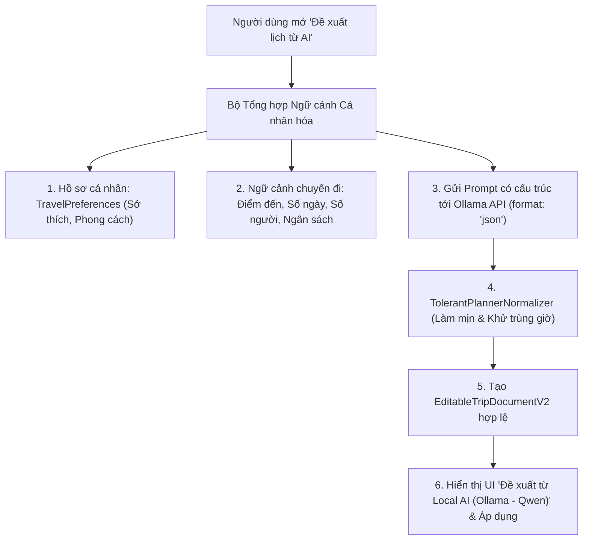

# Kế hoạch Triển khai: Local AI Planner Cá nhân hóa với Ollama (Qwen)

## 1. Mục tiêu và Bối cảnh
- **Bối cảnh**: Giảng viên chấm điểm đồ án đánh giá năng lực tích hợp **Local AI** (mô hình ngôn ngữ lớn chạy cục bộ trên máy tính qua Ollama) thay vì phụ thuộc API trả phí bên ngoài.
- **Mục tiêu**: Thay thế toàn bộ luồng tạo lịch trình bằng Google Gemini bằng **Local AI Planner** kết nối Ollama (`qwen3:4b-instruct-2507-q4_K_M`), cá nhân hóa sâu theo:
  1. **Sở thích từ Hồ sơ cá nhân (`TravelPreferences`)**: Tự động đọc danh sách sở thích, phong cách du lịch (`travelStyle`) và ngân sách thường dùng của tài khoản người dùng.
  2. **Tiêu chí chuyến đi**: Điểm đến (`destinationName`), Số ngày (`numDays`), Ngân sách dự kiến (`budgetVnd`).
  3. **Tiêu chí bổ sung**: Số người đi (`numPeople`), đối tượng đồng hành (Gia đình, Cặp đôi, Bạn bè, Một mình).

---

## 2. Kiến trúc Giải pháp



---

## 3. Danh sách File cần Chỉnh sửa / Tạo mới

| File | Vai trò | Thay đổi chính |
| :--- | :--- | :--- |
| `lib/features/trip_planner/services/local_ai_planner_service.dart` | **Mới** | Dịch vụ tổng hợp ngữ cảnh (Profile + Trip), gửi prompt sang Ollama và chuẩn hóa JSON thành `AiPreparedProposal`. |
| `lib/features/trip_planner/presentation/widgets/ai_generation_preview.dart` | **Sửa** | Đổi UI sang **"Đề xuất lịch từ Local AI (Ollama)"**, hiển thị huy hiệu Model Qwen cục bộ, bỏ checkbox gửi Gemini, thêm nhãn cá nhân hóa. |
| `lib/features/trip_planner/presentation/screens/manual_planner_screen.dart` | **Sửa** | Chuyển hàm `generate` trong modal sang gọi `LocalAiPlannerService`. |
| `test/local_ai_planner_personalized_test.dart` | **Mới** | Unit test kiểm thử parser, làm mịn mốc giờ và gộp sở thích cá nhân. |

---

## 4. Chi tiết Kỹ thuật

### 4.1. Tổng hợp Ngữ cảnh (Profile + Trip Input)
```dart
final profilePrefs = auth.currentUser?.travelPreferences;
final combinedInterests = <String>{
  ...?profilePrefs?.interests,
  ...document.input.interests,
}.toList();
final travelStyle = profilePrefs?.travelStyle ?? 'Khám phá & Nghỉ dưỡng';
```

### 4.2. Prompt Engineering cho Ollama Qwen (Format: JSON)
* **System Prompt**: Yêu cầu Ollama đóng vai trò Chuyên gia Lập lịch trình của TravelGO.
* **User Prompt**: Truyền đầy đủ:
  * Điểm đến
  * Số ngày ($1..N$)
  * Số người
  * Ngân sách tổng (VNĐ)
  * Sở thích cá nhân & phong cách du lịch
* **Structured Output**: Ép trả về JSON gồm `summary` và mảng `activities`.

### 4.3. TolerantPlannerNormalizer (Bộ làm mịn & Sửa lỗi giờ)
* Đảm bảo mốc giờ không bị khuyết và không bị chồng chéo:
  * Hoạt động 1 (Sáng): `08:30 - 10:30` (510 - 630 phút)
  * Hoạt động 2 (Trưa): `11:30 - 13:00` (690 - 780 phút)
  * Hoạt động 3 (Chiều): `14:30 - 17:00` (870 - 1020 phút)
  * Hoạt động 4 (Tối): `18:30 - 20:30` (1110 - 1230 phút)
* Ánh xạ chính xác các category: `food`, `attractions`, `transport`, `shopping`, `other`.
* Khởi tạo UUID v4 chuẩn cho Day ID và Item ID để bảo đảm tương thích tuyệt đối với `EditableTripValidator`.

---

## 5. Kế hoạch Kiểm thử & Nghiệm thu
1. **Unit Test**: Test parser với các trường hợp:
   - JSON hoàn hảo từ Ollama.
   - JSON bị thiếu giờ hoặc trùng giờ (Adapter tự động sửa mốc giờ).
   - JSON khi có và không có sở thích từ hồ sơ cá nhân.
2. **Widget Test**: Kiểm tra màn hình `AiGenerationPreview` hiển thị đúng thông tin "Local AI (Ollama - Qwen)" và cho phép áp dụng lịch trình thành công vào chuyến đi.
3. **Analyzer**: `flutter analyze` đạt 0 issues.
4. **Trực quan trên thiết bị**: Thử nghiệm trực tiếp trên điện thoại/máy ảo với Ollama đang chạy trên máy tính.
